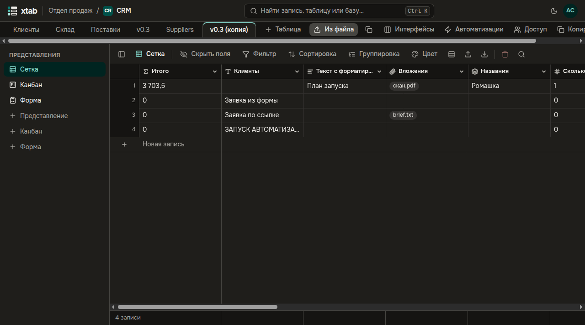

Таблицы базы — вкладки под верхней строкой. Открывается первая таблица.

- **Новая таблица:** нажмите **+ Таблица** справа от вкладок, введите название и нажмите Enter. В новой таблице уже есть поле «Название».
- **Таблица из файла CSV или Excel:** нажмите **Из файла** справа от вкладок — см. раздел «Импорт из CSV и Excel».
- **Другая таблица:** нажмите на её вкладку.
- **Копия таблицы:** откройте таблицу и нажмите значок копирования справа от **Из файла**, при желании измените название и нажмите **Копировать**. Копия появится новой вкладкой: те же поля, записи, файлы и общие представления. Если таблица связана с другой, в той появится обратное поле с названием копии.
- **Копия базы:** нажмите **Копировать базу** в конце строки вкладок. Копия откроется сразу: все таблицы, связи между ними, представления и автоматизации. Автоматизации в копии выключены и без секретов — включите их и задайте секреты заново, когда будете готовы.

Копия — это данные на момент, когда вы нажали **Копировать**: изменения, сделанные во время копирования, в неё не попадают. Большая база копируется несколько минут, кнопка показывает «Копируется…». Публичные ссылки форм и личные представления не копируются.

В верхней строке видно, в каком пространстве и какой базе вы находитесь. Чтобы вернуться на главную, нажмите на значок xtab слева.
