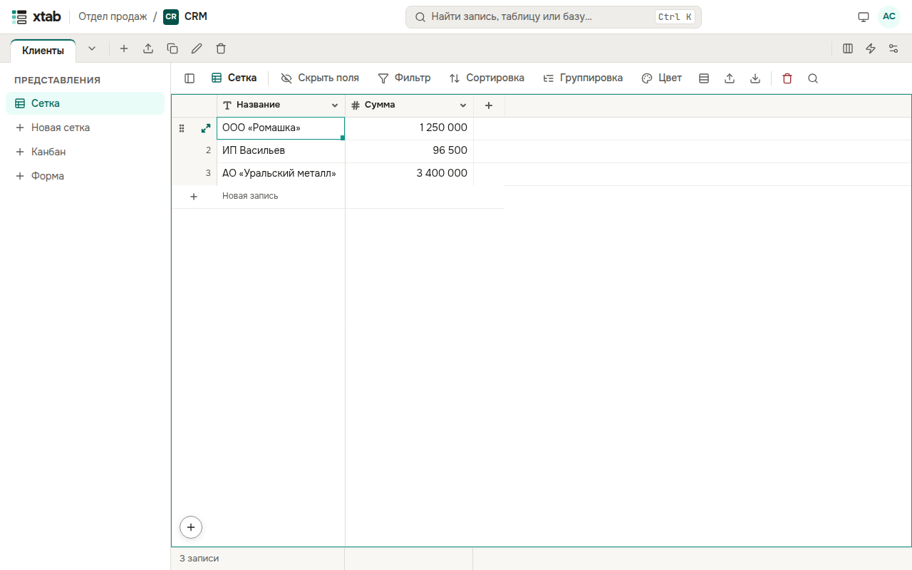

Таблица показывает записи строками, поля — колонками. Первая колонка — главное поле записи: она остаётся на месте, когда таблица прокручивается вправо. Внизу показано, сколько записей в представлении.

- **Выбрать ячейку:** нажмите на неё. По ячейкам можно ходить стрелками, Tab, Page Up и Page Down, Home и End.
- **Изменить значение:** нажмите Enter или дважды на ячейку, либо просто начните печатать. Enter или Tab сохраняют значение, Esc отменяет правку. Числа можно вводить с пробелами и запятой: `1 250 000,50`. В ячейке **Несколько из списка**, **Пользователь** или **Связь** набранные буквы попадают в поиск списка; в ячейке **Один из списка** буква выбирает первый вариант, который с неё начинается. В ячейке даты первый символ открывает поле даты — дату введите в нём.
- **Флажок:** нажмите Enter или ещё раз на выбранную ячейку.
- **Очистить ячейку:** нажмите Delete.
- **Новая запись:** нажмите круглую кнопку **+** в левом нижнем углу таблицы (подсказка «Новая запись») — она видна при любой прокрутке, а в конце прокрутки не закрывает записи — или строку **Новая запись** под последней записью. В сгруппированной таблице кнопка добавляет запись в группу выбранной ячейки, а если ячейка не выбрана — в последнюю группу.
- **Новая запись под выбранной:** нажмите Shift+Enter. Запись выше или ниже выбранной добавляют и пункты **Вставить запись выше** и **Вставить запись ниже** в меню правой кнопки мыши.
- **Удалить запись:** выберите любую её ячейку и нажмите значок корзины над таблицей, затем подтвердите.

Поля, которые заполняет система (время создания, автор, автономер), изменить нельзя.
