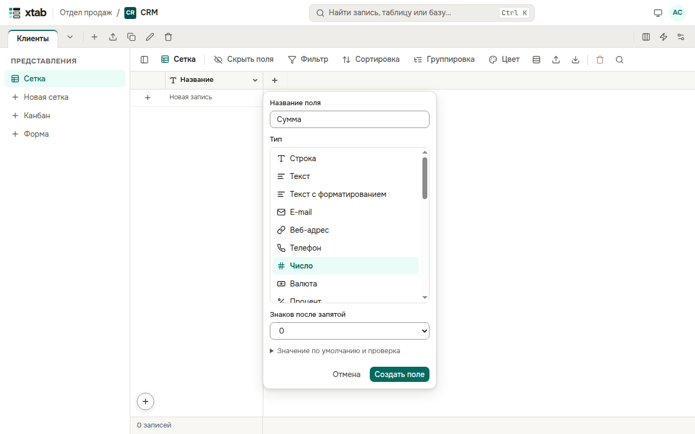
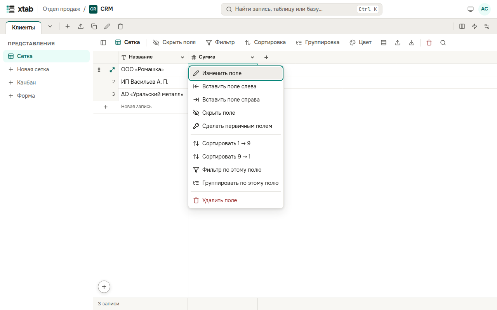
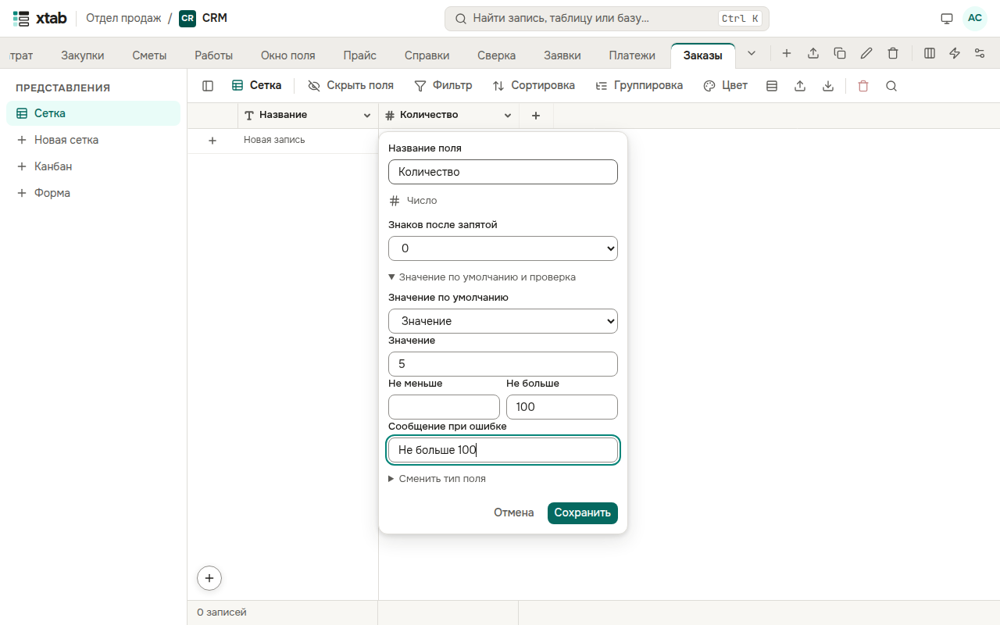
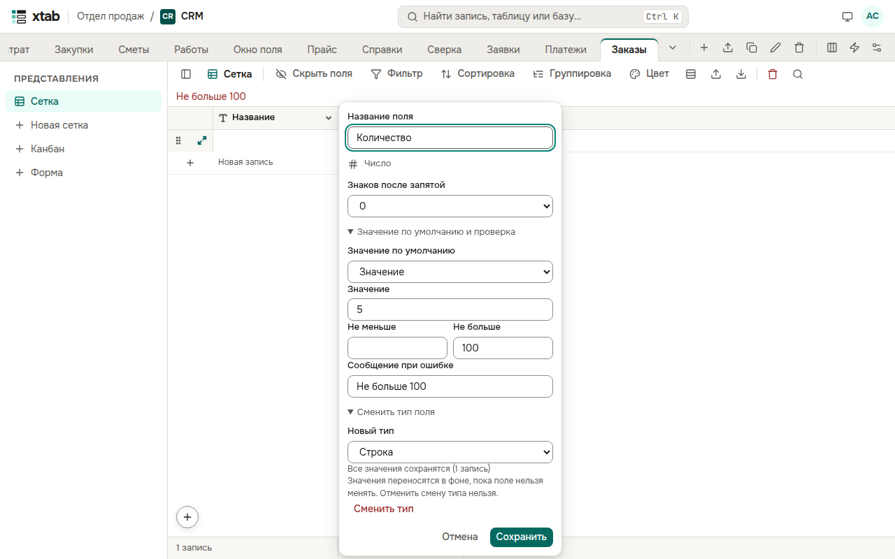

У каждого поля есть тип. Значок типа показан в заголовке колонки.

- **Текст и контакты:** строка, текст, e-mail, веб-адрес, телефон.
- **Числа:** число, валюта, процент, длительность, рейтинг.
- **Выбор:** флажок, один из списка, несколько из списка, пользователь.
- **Даты:** дата, дата и время.
- **Связи между таблицами:** связь, подстановка, количество связей, сводка по связи.
- **Вычисления:** формула.
- **Файлы:** вложения.
- **Заполняет система:** автономер, время создания или изменения, автор или изменивший.

**Новое поле в конце таблицы:** нажмите **+** справа от последней колонки, введите название, выберите тип и нажмите **Создать поле**. Для полей «Один из списка» и «Несколько из списка» здесь же добавьте варианты кнопкой **Добавить вариант** (Enter в названии варианта добавляет следующий, а вставленный список — по варианту на строку) и выберите их цвета; значение по умолчанию и проверку можно задать сразу, в том же разделе, что в окне **Изменить поле**.

**Меню поля:** нажмите правой кнопкой на заголовок колонки или левой — на стрелку ▾ справа в заголовке. Обычный щелчок по заголовку выделяет колонку. С клавиатуры — Ctrl+Shift+F10 на выбранной ячейке колонки; новое поле с клавиатуры — пункт **Вставить поле справа** или **слева** этого меню. Во всех меню стрелки ↑ и ↓ переходят по пунктам, Enter выбирает пункт, Escape закрывает меню и возвращает туда, откуда его открыли.

- **Изменить поле** — новое название, варианты списка и их цвета, число знаков после запятой или текст формулы. У каждого варианта своя строка: название, кружок цвета (открывает палитру), кнопки «поднять», «опустить» и «удалить»; порядок меняется и перетаскиванием за маркер слева, и клавишами Alt+↑ / Alt+↓ в названии. Исправленное название переименовывает вариант: у записей он остаётся, уже с новым названием. Если удалить вариант, который стоит у записей, перед сохранением xtab скажет, сколько записей потеряют это значение. Новые варианты сразу получают разные цвета. У связи здесь же переключается **Только одна запись** (если у какой-то записи уже несколько связей, xtab скажет об этом) и видно её встречное поле со ссылкой **Перейти к полю**, у сводки — выражение и условие (после сохранения значения пересчитываются). Поле связи и поле связанной таблицы у подстановки, количества и сводки видны, но не меняются: они задаются при создании, чтобы выбрать другие — создайте новое поле. Если поле изменили, пока окно открыто, — вы в другом окне или другой человек, — окно не закрывается, а показывает «Поле изменено в другом окне или другим пользователем.» и кнопку **Обновить**: она показывает новые настройки; если вы уже изменили что-то кроме названия, xtab сначала спросит, можно ли потерять эти изменения.
- **Вставить поле слева** или **справа** — новое поле рядом с этим.
- **Сделать первичным полем** — поле становится первой колонкой и названием записи: его значение видно в связях, в быстром переходе и в заголовке записи. Первичным может быть и формула.
- **Скрыть поле** — колонка пропадает из этого представления, данные остаются.
- **Сортировать** (А → Я или Я → А, для чисел 1 → 9 или 9 → 1, для дат — сначала старые или сначала новые, для выбора — по порядку вариантов или в обратном порядке) — представление сортируется сначала по этому полю, остальные условия сортировки остаются после него.
- **Фильтр по этому полю** — открывается панель фильтра с новым условием по полю.
- **Группировать по этому полю** — добавляет уровень группировки; пункт неактивен, если по полю уже группируется или уровней три.
- Без права менять представление сортировка, фильтр и группировка из меню действуют только у вас, как в панелях.
- **Удалить поле** — поле удаляется вместе со всеми его значениями, после подтверждения. Первичное поле удалить нельзя.

**Значение по умолчанию и проверка** — раздел в окне нового поля и в окне **Изменить поле**. Значение по умолчанию подставляется в новую запись: текст или число, **Сегодня** и **Сейчас** для дат, **Тот, кто создаёт запись** для поля «Пользователь», **Отмечено** для флажка, вариант или несколько вариантов для полей-списков. Варианты появляются в списке значения сразу, как вы их вводите, сохранять поле заранее не нужно; удалённый или переименованный вариант перестаёт быть значением по умолчанию. Проверка не даёт сохранить неподходящее значение: **Не меньше** и **Не больше** для чисел, **Длина от** и **Длина до** для текста, **Шаблон** — например, `[A-Z]{2}-\d{3}` для кода вида «AB-123». В **Сообщении при ошибке** напишите, что человеку исправить.

**Сменить тип поля** — раздел в том же окне. Выберите **Новый тип**: xtab проверит значения и покажет, сохранятся ли все или сколько станут пустыми, с примерами, а для чисел — сколько округлятся до знаков после запятой нового типа, с первым примером «до → после». Нажмите **Сменить тип**: значения переносятся в фоне, а поле в это время нельзя менять. Отменить смену типа нельзя — если важные значения не преобразуются, создайте новое поле.

