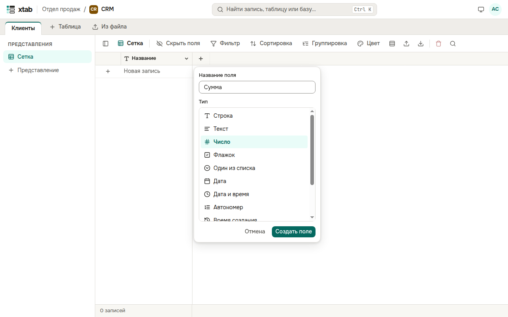
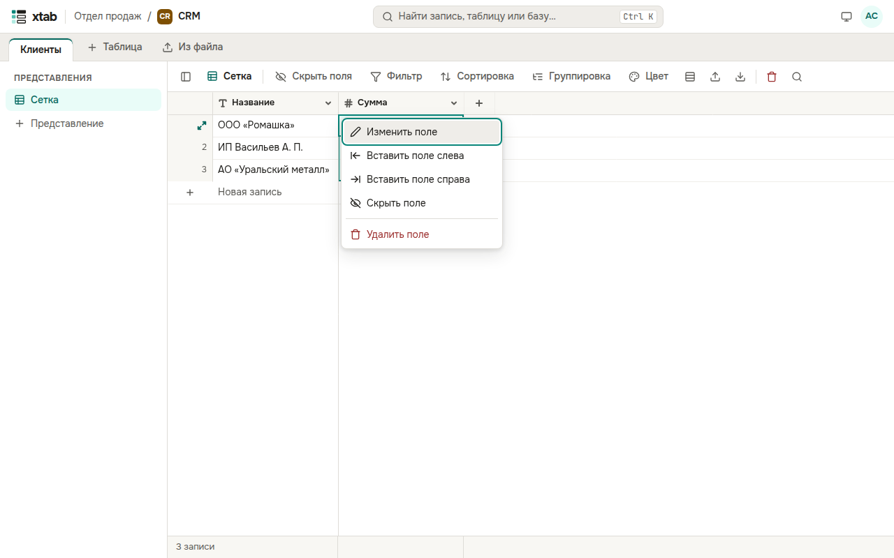

У каждого поля есть тип: строка, текст, число, флажок, один из списка, дата, дата и время, автономер, время создания или изменения, автор или изменивший. Значок типа показан в заголовке колонки.

**Новое поле в конце таблицы:** нажмите **+** справа от последней колонки, введите название, выберите тип и нажмите **Создать поле**.

**Меню поля:** нажмите на заголовок колонки.

- **Изменить поле** — новое название, варианты списка (по одному в строке) или число знаков после запятой.
- **Вставить поле слева** или **справа** — новое поле рядом с этим.
- **Скрыть поле** — колонка пропадает из этого представления, данные остаются.
- **Удалить поле** — поле удаляется вместе со всеми его значениями, после подтверждения. Главное поле удалить нельзя.
