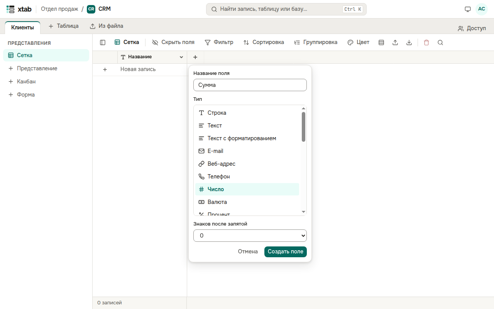
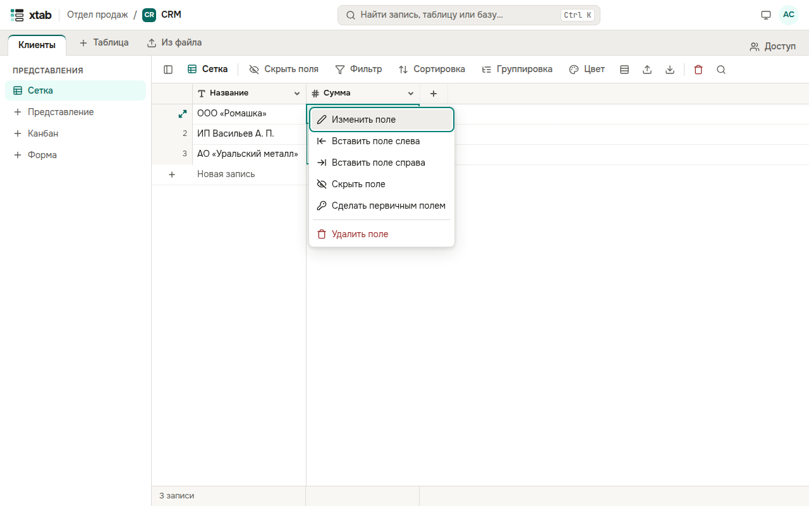
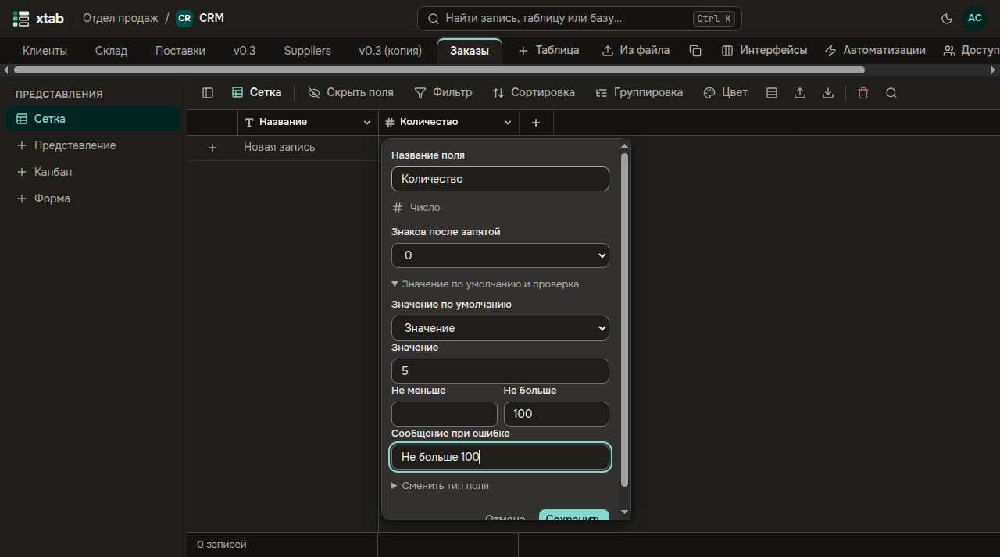
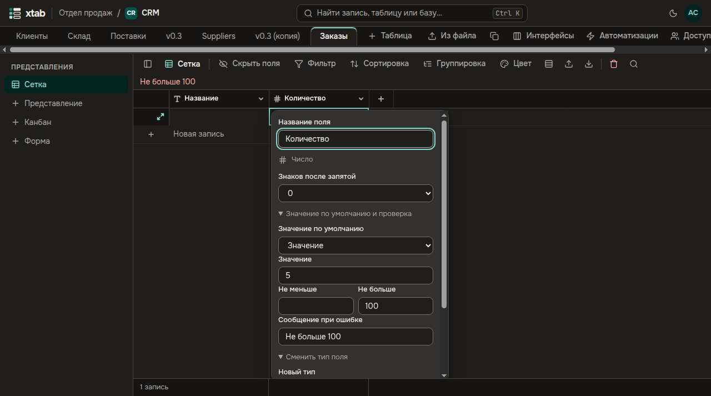

У каждого поля есть тип. Значок типа показан в заголовке колонки.

- **Текст и контакты:** строка, текст, e-mail, веб-адрес, телефон.
- **Числа:** число, валюта, процент, длительность, рейтинг.
- **Выбор:** флажок, один из списка, несколько из списка, пользователь.
- **Даты:** дата, дата и время.
- **Связи между таблицами:** связь, подстановка, количество связей, сводка по связи.
- **Вычисления:** формула.
- **Файлы:** вложения.
- **Заполняет система:** автономер, время создания или изменения, автор или изменивший.

**Новое поле в конце таблицы:** нажмите **+** справа от последней колонки, введите название, выберите тип и нажмите **Создать поле**.

**Меню поля:** нажмите на заголовок колонки.

- **Изменить поле** — новое название, варианты списка (по одному в строке), число знаков после запятой или текст формулы.
- **Вставить поле слева** или **справа** — новое поле рядом с этим.
- **Сделать первичным полем** — поле становится первой колонкой и названием записи: его значение видно в связях, в быстром переходе и в заголовке записи. Первичным может быть и формула.
- **Скрыть поле** — колонка пропадает из этого представления, данные остаются.
- **Удалить поле** — поле удаляется вместе со всеми его значениями, после подтверждения. Первичное поле удалить нельзя.

**Значение по умолчанию и проверка** — раздел в окне **Изменить поле**. Значение по умолчанию подставляется в новую запись: текст или число, **Сегодня** и **Сейчас** для дат, **Тот, кто создаёт запись** для поля «Пользователь», **Отмечено** для флажка. Проверка не даёт сохранить неподходящее значение: **Не меньше** и **Не больше** для чисел, **Длина от** и **Длина до** для текста, **Шаблон** — например, `[A-Z]{2}-\d{3}` для кода вида «AB-123». В **Сообщении при ошибке** напишите, что человеку исправить.

**Сменить тип поля** — раздел в том же окне. Выберите **Новый тип**: xtab проверит значения и покажет, сохранятся ли все или сколько станут пустыми, с примерами. Нажмите **Сменить тип**: значения переносятся в фоне, а поле в это время нельзя менять. Отменить смену типа нельзя — если важные значения не преобразуются, создайте новое поле.

