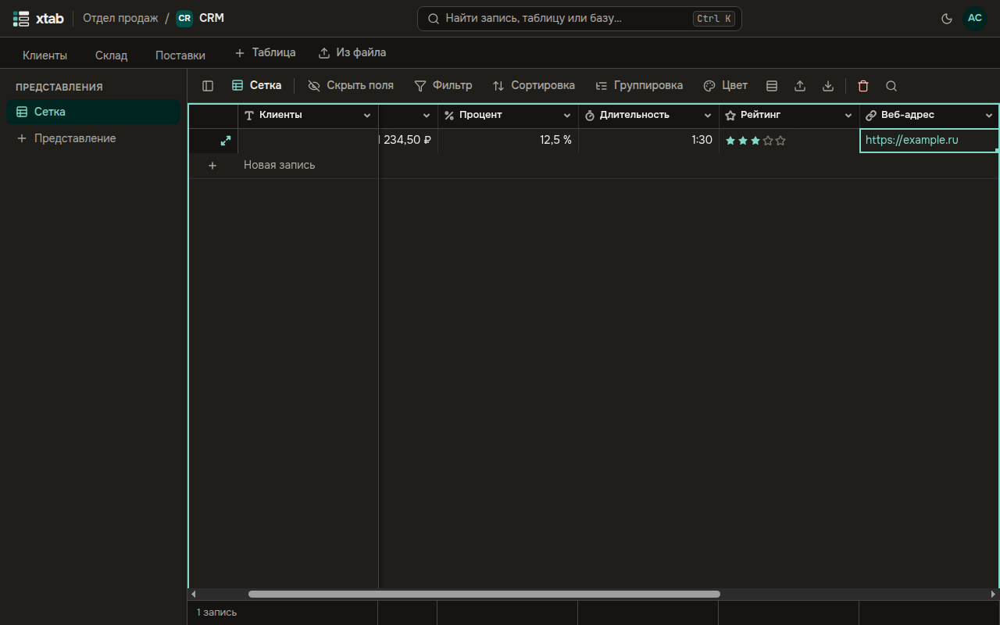
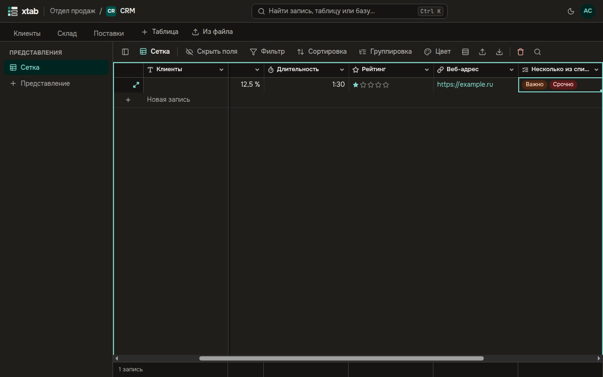

- **Валюта, процент, длительность:** вводите как привыкли: `1 234,50`, `12,5`, `1:30`. Значок валюты, знак процента и часы с минутами xtab добавит сам.
- **Рейтинг:** нажмите на нужную звезду.
- **E-mail и веб-адрес:** адрес становится ссылкой.

- **Несколько из списка:** выберите ячейку и нажмите Enter. Отметьте нужные варианты — в ячейке они появятся в том порядке, в каком вы их отмечали.
- **Пользователь:** нажмите Enter, начните вводить имя участника и выберите его из списка. В настройке поля можно разрешить **Несколько человек в ячейке**.

