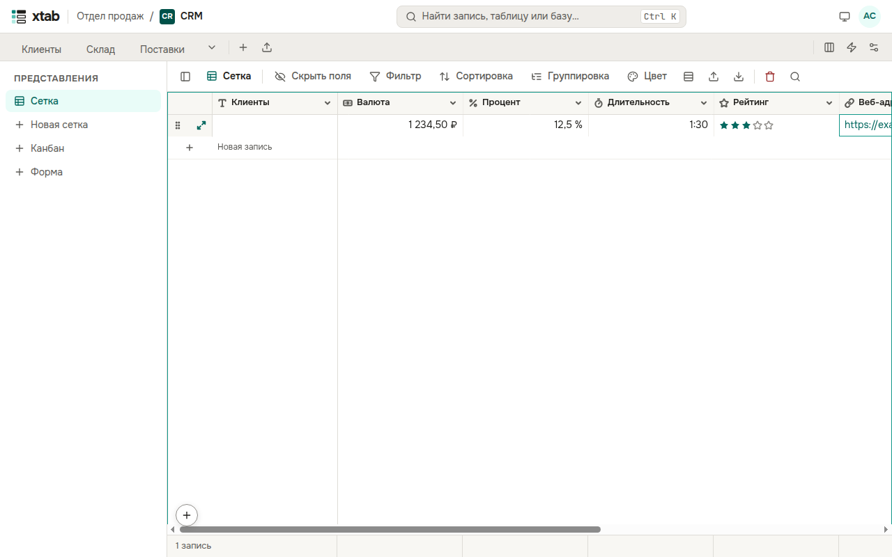
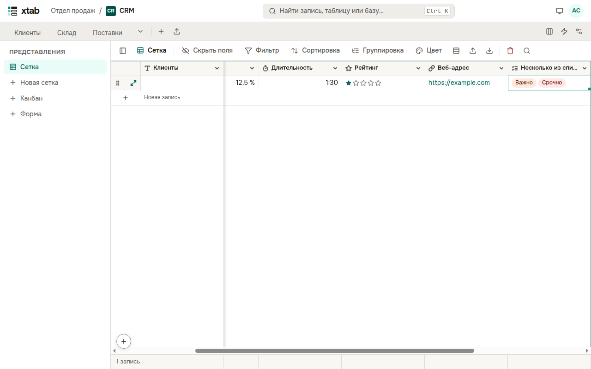

- **Валюта, процент, длительность:** вводите как привыкли: `1 234,50`, `12,5`, `1:30`. Знак валюты, знак процента и часы с минутами xtab добавит сам. Если знак валюты в таблице лишний, снимите флажок **Показывать знак валюты** рядом с выбором валюты в окне **Изменить поле** — сумма останется с тем же числом знаков после запятой и разделителями разрядов, в сетке, итогах, окне записи, формах, канбане и интерфейсах. Это только вид: значение, фильтры, сортировка и экспорт не меняются.
- **Рейтинг:** нажмите на нужную звезду.
- **E-mail и веб-адрес:** адрес становится ссылкой.

- **Дата и время, время создания и время изменения:** чтобы видеть только дату, снимите флажок **Показывать время** в окне **Изменить поле** — то же у формулы, подстановки и сводки, которые дают дату со временем. Дата показывается в вашем часовом поясе. Это только вид: время по-прежнему хранится и вводится, а фильтры, сортировка, группировка и экспорт работают с полным значением. В окне записи поле «Дата и время» показывает и время — чтобы его можно было исправить.
- **Несколько из списка:** выберите ячейку и нажмите Enter или начните вводить название варианта — поле поиска оставит подходящие. Отметьте нужные варианты — в ячейке они появятся в том порядке, в каком вы их отмечали.
- **Пользователь:** нажмите Enter или просто начните вводить имя участника на выбранной ячейке и выберите его из списка. В настройке поля можно разрешить **Несколько человек в ячейке** — тогда у правого края ячейки видно, сколько всего в ней человек. Участник, который не указал имя в профиле, показывается как «Без имени».

