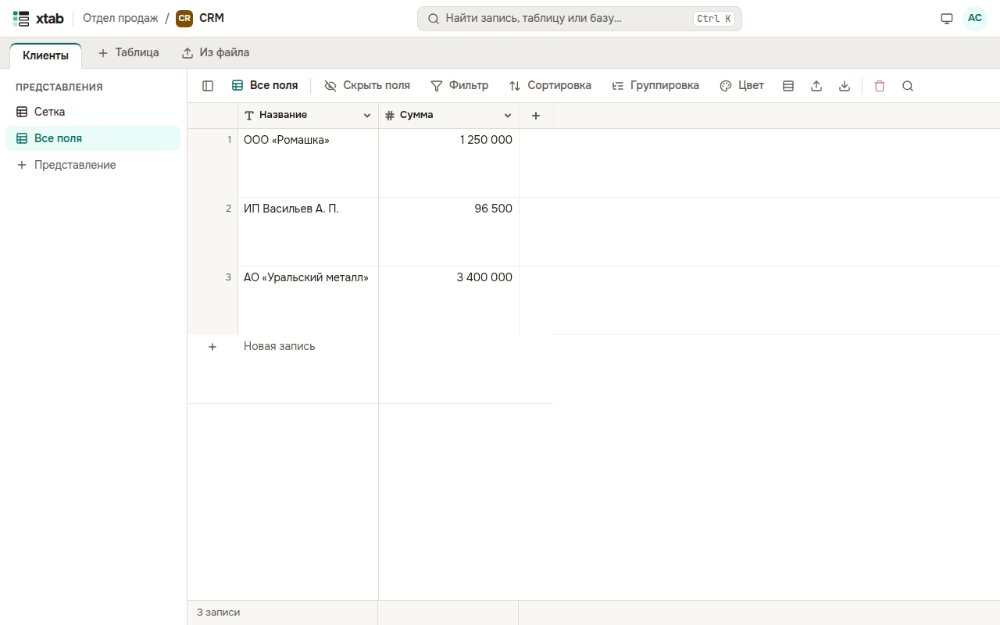

Представление — это способ смотреть на таблицу: какие поля видны, в каком порядке и какой ширины колонки, какие записи отобраны, как они отсортированы, сгруппированы и раскрашены. У одной таблицы может быть много представлений, данные у них общие. Список представлений — слева от таблицы; кнопка с панелью в начале строки над таблицей прячет и показывает его.

- **Новое представление:** нажмите **+ Представление** в списке слева, введите название и нажмите Enter. В новом представлении видны все поля.
- **Переименовать, дублировать, удалить:** наведите указатель на представление в списке и нажмите карандаш, значок копии или корзину. Последнее представление таблицы удалить нельзя.
- **Скрыть поля:** нажмите **Скрыть поля** над таблицей и выключите ненужные поля; **Скрыть все** и **Показать все** — разом.
- **Высота строк:** нажмите значок строк над таблицей и выберите **Низкие**, **Средние** или **Высокие**.
- **Ширина колонки:** потяните за правый край заголовка колонки.

Каждое представление помнит свои настройки. Все, кто открывает представление, видят его одинаково.
