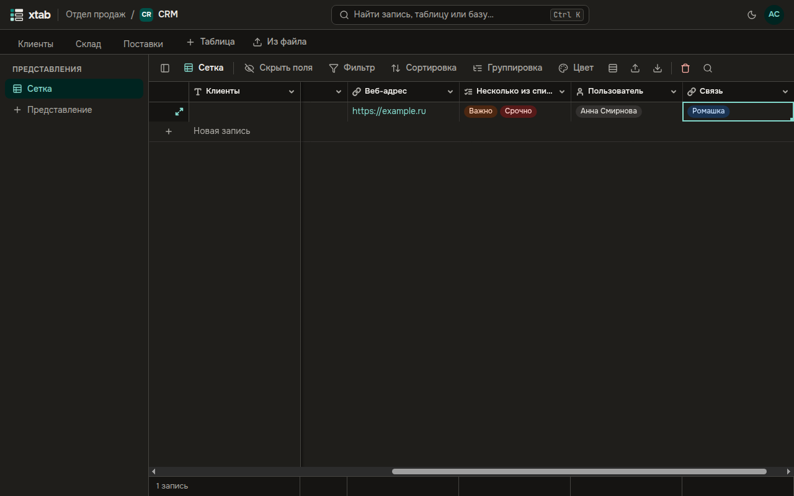

Поле **Связь** соединяет запись с записями другой таблицы: например, клиента — с его поставщиками.

**Создать связь:** добавьте поле типа **Связь** и выберите **Связанную таблицу**. Если в ячейке должна быть только одна запись, включите **Только одна запись**. В связанной таблице появится обратное поле: связь видна с обеих сторон.

**Связать записи:** выберите ячейку и нажмите Enter. Найдите запись по названию и выберите её из списка; крестик на плашке убирает связь.

- Связи можно вставлять из буфера обмена — названиями связанных записей.
- По связи можно фильтровать, сортировать и группировать записи — по названиям связанных записей.
- В экспорт попадают названия связанных записей.
