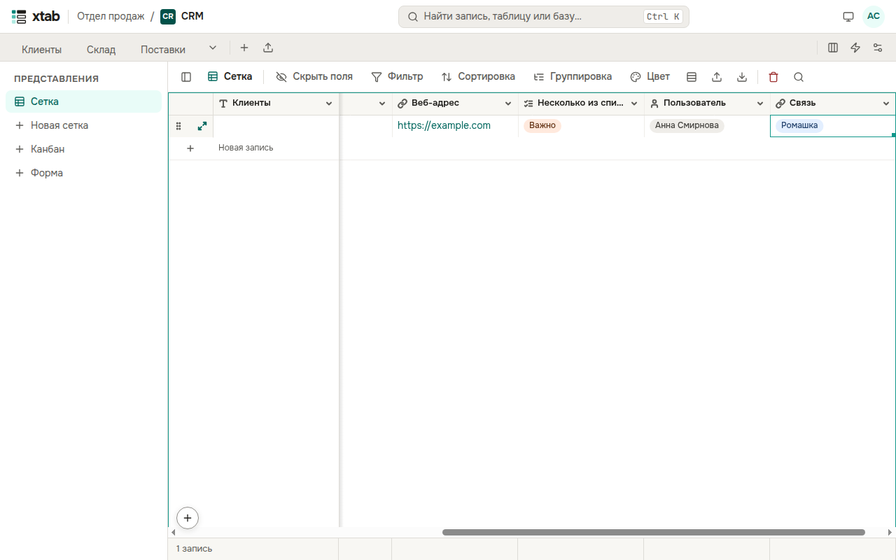

Поле **Связь** соединяет запись с записями другой таблицы: например, клиента — с его поставщиками.

**Создать связь:** добавьте поле типа **Связь** и выберите **Связанную таблицу**. Если в ячейке должна быть только одна запись, включите **Только одна запись**. В связанной таблице появится встречное поле — связь видна с обеих сторон. Его название задаётся здесь же, в поле **Название встречного поля**: заранее там название этой таблицы, а если в связанной таблице поле с таким названием уже есть — название таблицы и в скобках название новой связи, например «Договоры (Бюджет)». Название можно изменить; если оно занято, xtab скажет об этом под полем. Какое поле встречное, видно в окне **Изменить поле** связи — строка «Встречное поле: «…» в таблице «…»», а ссылка **Перейти к полю** открывает связанную таблицу с выделенной колонкой этого поля (если поле скрыто в представлении, xtab скажет об этом), — и в подсказке при наведении на заголовок колонки связи. У связи таблицы с самой собой встречного поля нет: там написано «Без встречного поля».

**Связать записи:** выберите ячейку и нажмите Enter или просто начните вводить название записи. Найдите запись по названию и выберите её из списка; крестик на плашке убирает связь. Если под ячейкой мало места, список открывается над ней. Запись, у которой не заполнено первичное поле, показывается как «Без названия». Если в ячейке можно выбрать несколько записей, у её правого края видно общее число связей, а названия, которым не хватило места, обрезаются многоточием.

**Список выбора** одинаков в ячейке, окне записи, формах и условиях фильтра — так же выбираются участники и варианты поля **Несколько из списка**. Вне ячейки это компактное поле: выбранное показано в нём плашками с крестиком (или названием, если выбирается одно значение), а список открывается под полем — или над ним, если внизу мало места, — по щелчку, при вводе или по ↓ и не раздвигает форму. Длинные названия обрезаются многоточием, полностью их видно в подсказке. Список показывает записи порциями: прокрутите его вниз, и догрузятся следующие; ввод части названия сужает список. С клавиатуры: ↑ и ↓ — по пунктам, Enter — выбрать (если можно выбрать несколько, список остаётся открытым), Esc — закрыть список, Backspace в пустом поле — убрать последнюю плашку. Если записей очень много, после 10 000 список остановится с подсказкой «Показаны первые … — уточните поиск»; если список не загрузился, в нём будет «Не удалось загрузить список — попробуйте ещё раз».

- Связи можно вставлять из буфера обмена — названиями связанных записей.

**Выбирать только подходящие записи:** в настройках поля **Связь** (меню заголовка → **Изменить поле**) раздел **Выбирать только записи, где…** сужает список выбора. Условия задаются как фильтр представления — по полям связанной таблицы и по полям таблиц дальше по связям (например, **Проект → Заказчик**). Кнопка **Условие по полю этой записи** сравнивает связь или пользователя записи-кандидата со значением поля заполняемой записи: например, «**Проект** содержит любой из **Проект этой записи**» — в Договоре предлагаются только Бюджеты выбранного в нём Проекта.

У строки такого условия две стороны, и над каждой написано, чья она. Левая — **У записи из списка** (запись связанной таблицы, которую предлагают выбрать): её поле или путь по связям от неё. Правая — **У этой записи** (запись, которую заполняют): её поле, с которым сравнивают. Если стороны перепутать, условие ничего не сузит, поэтому под строкой появляется предупреждение — сохранить такое условие всё равно можно. «Путь ведёт обратно в таблицу …» — левый путь начинается со связи обратно в таблицу этой записи (например, у поля **Номенклатура** таблицы **Бюджеты** слева выбрано **Бюджеты → Проект**): условие проверит другие записи этой таблицы, а не заполняемую. Такие пути в списке левой стороны стоят последними. «Это поле заполняется этим выбором…» — справа выбрано само настраиваемое поле или путь через него (например, **Номенклатура → Группа этой записи** у поля **Номенклатура**): пока поле пустое, условие список не сужает.

- Пока поле этой записи пустое, его условие список не сужает, а над списком появляется подсказка «Выберите «Проект», чтобы сузить список». В форме значения учитываются сразу, ещё до сохранения.
- Уже выбранная связь, которая перестала подходить (например, сменили Проект), не удаляется: в списке выбора, в окне записи и в форме она помечена значком «Не подходит под условие поля».
- Условие только помогает выбрать: вставка, импорт, API и автоматизации записывают любые связи.
- Если поле из условия удалили, эта часть условия перестаёт действовать — выбор становится шире, а в настройках поля появляется надпись «Часть условия ссылается на поле, которого больше нет, и не действует».
- Если список не удалось отобрать вовремя, появится «Не успели отобрать записи — уточните поиск»: введите часть названия.
- По связи можно фильтровать, сортировать и группировать записи — по названиям связанных записей.
- В экспорт попадают названия связанных записей.
