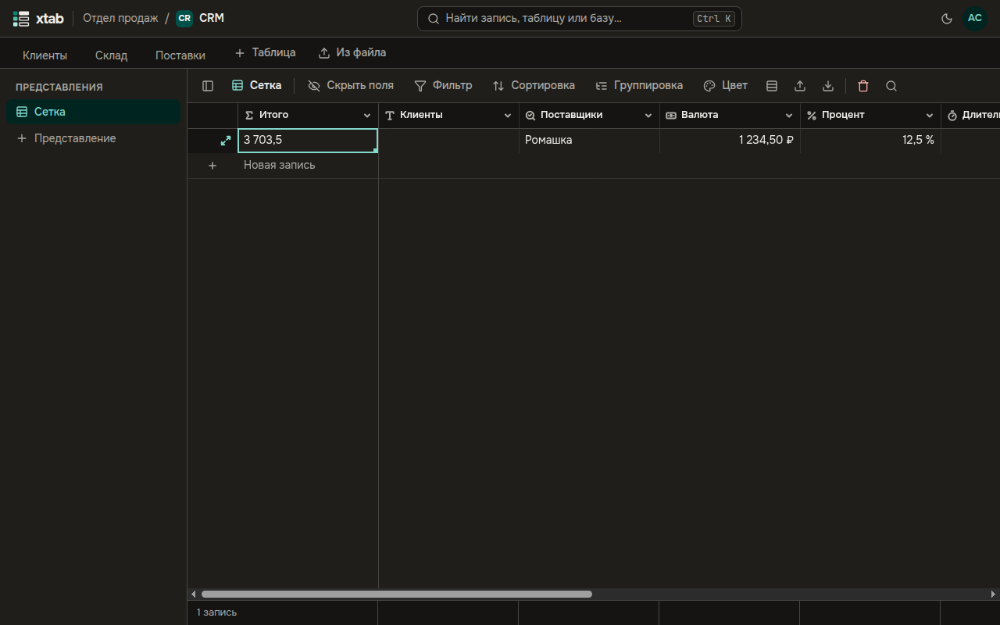
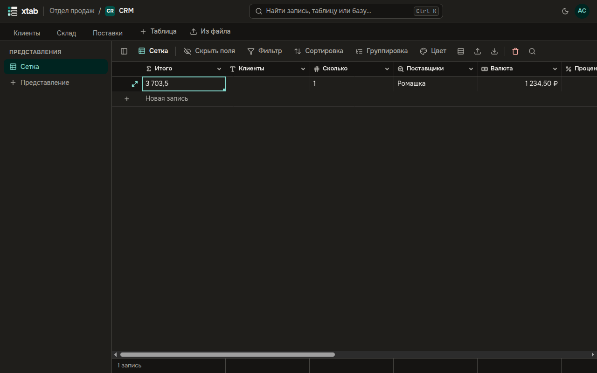
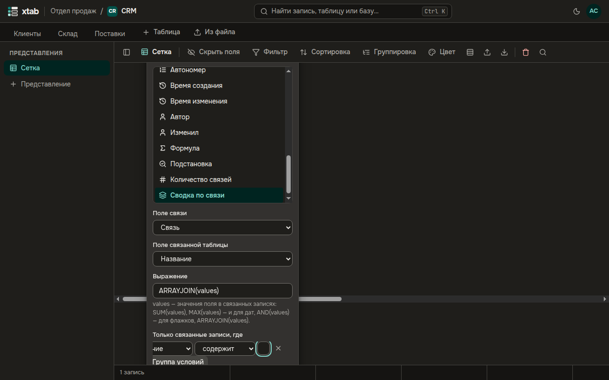
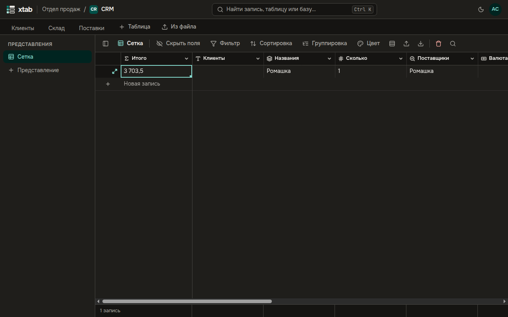

Эти поля берут данные из связанных записей и сами обновляются, когда связанные записи меняются.

- **Подстановка** показывает значения выбранного поля связанных записей: например, города поставщиков. В форме поля выберите **Поле связи** и **Поле связанной таблицы**.
- **Количество связей** считает, сколько записей связано. Выберите **Поле связи**.

- **Сводка по связи** вычисляет одно значение по связанным записям. Выберите **Поле связи** и **Поле связанной таблицы**, затем задайте **Выражение**. `values` в нём — значения поля в связанных записях:
  - `SUM(values)` — сумма;
  - `MAX(values)` — наибольшее, в том числе для дат;
  - `AND(values)` — для флажков;
  - `ARRAYJOIN(values)` — все значения через запятую.

  В блоке **Только связанные записи, где** можно оставить в сводке только подходящие записи — условия задаются так же, как в фильтре.

