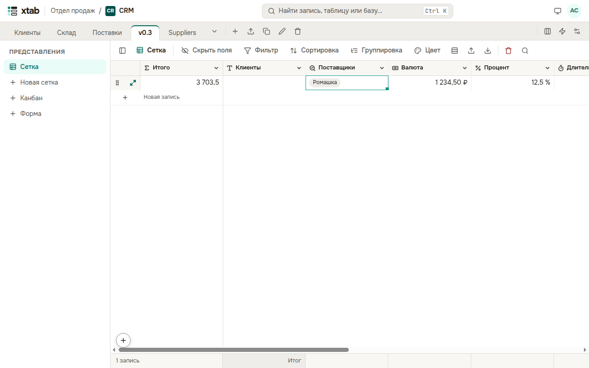
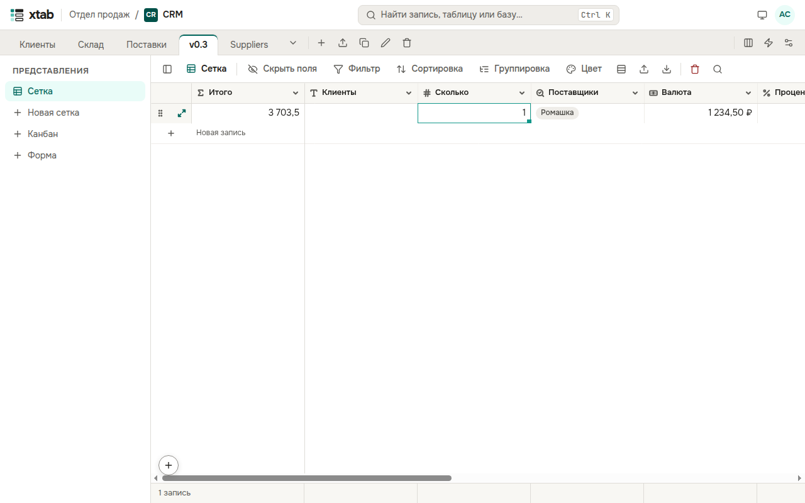
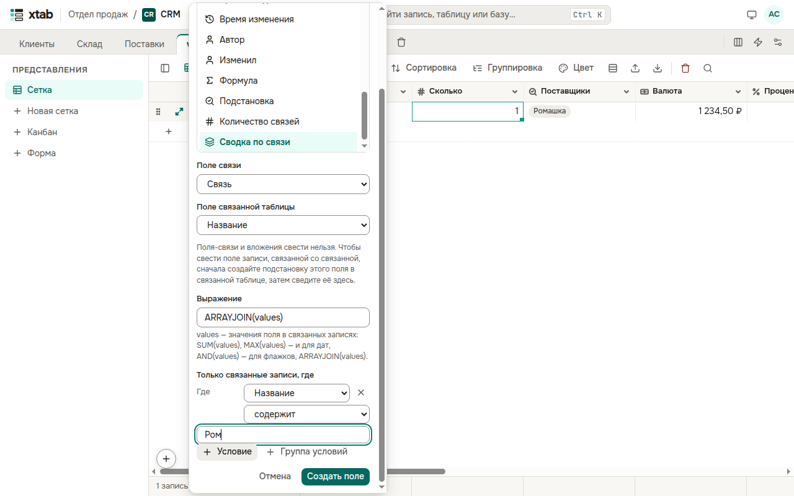
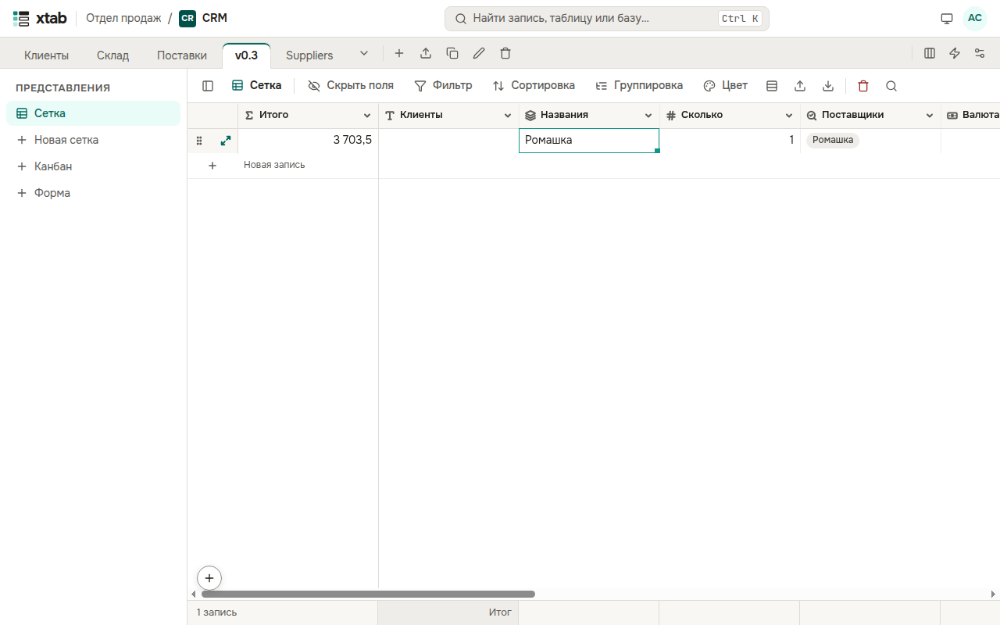

Эти поля берут данные из связанных записей и сами обновляются, когда связанные записи меняются.

- **Подстановка** показывает значения выбранного поля связанных записей: например, города поставщиков. В форме поля выберите **Поле связи** и **Поле связанной таблицы**. В таблице каждое значение стоит на своей серой плашке, а в окне записи, канбане, списке и заголовках групп значения разделены точкой с запятой — так числа с запятой не сливаются: «123 456,11; 11 235».
- **Количество связей** считает, сколько записей связано. Выберите **Поле связи**.

По подстановке текстов — названий, вариантов выбора, имён людей — можно фильтровать, сортировать и группировать: её значения сравниваются как один текст через запятую. Подстановку чисел, дат и флажков в фильтре, сортировке и группировке пока выбрать нельзя — сделайте над ней формулу, например `ARRAYJOIN({Цены}, ", ")` или `SUM({Цены})`, и фильтруйте по формуле.

Поля-связи и вложения подставить нельзя — их нет в списке **Поле связанной таблицы**. Чтобы показать поле записи, связанной со связанной, сделайте две подстановки. Например, в «Номенклатуре» связь «Группа» ведёт в «Номенклатурные группы», а у групп есть связь «Словарь»: сначала в «Номенклатурных группах» создайте подстановку «Название словаря» через связь «Словарь», затем в «Номенклатуре» — подстановку этого поля через связь «Группа».

- **Сводка по связи** вычисляет одно значение по связанным записям. Выберите **Поле связи** и **Поле связанной таблицы**, затем задайте **Выражение**. `values` в нём — значения поля в связанных записях:
  - `SUM(values)` — сумма;
  - `MAX(values)` — наибольшее, в том числе для дат;
  - `AND(values)` — для флажков;
  - `ARRAYJOIN(values)` — все значения через запятую.

  В блоке **Только связанные записи, где** можно оставить в сводке только подходящие записи — условия задаются так же, как в фильтре.

