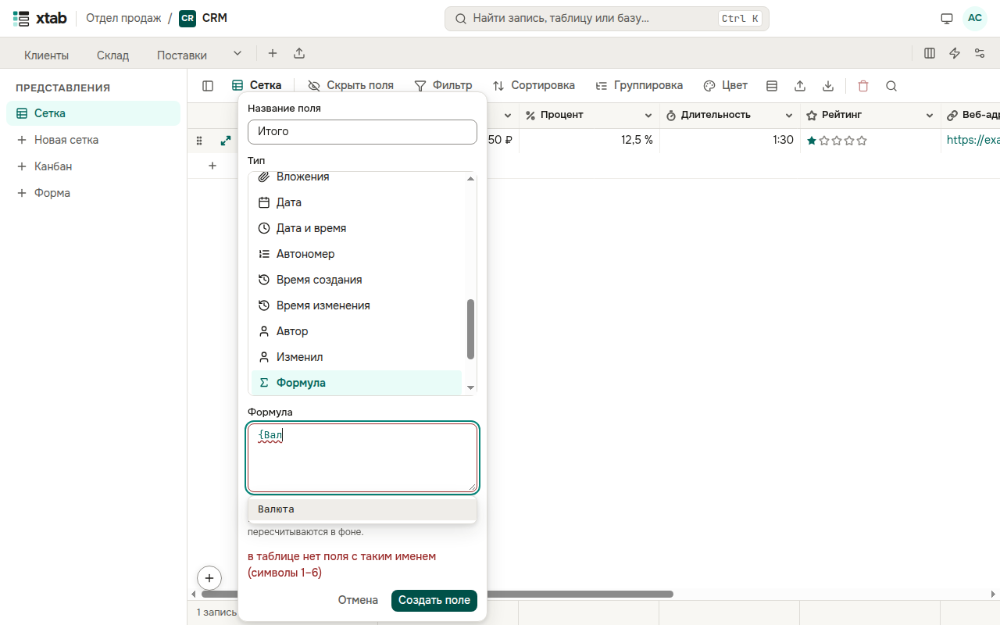
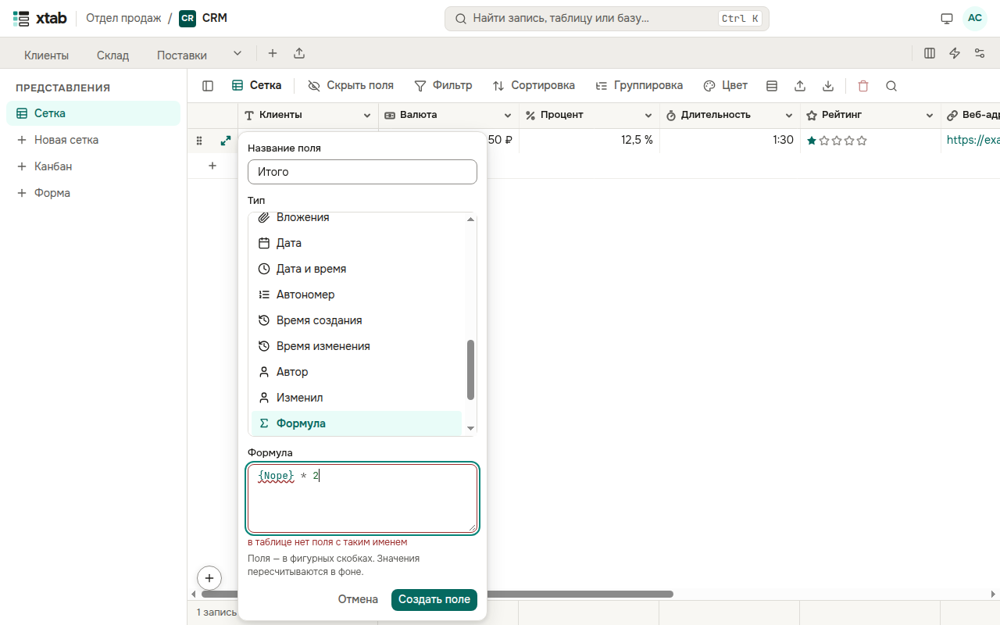
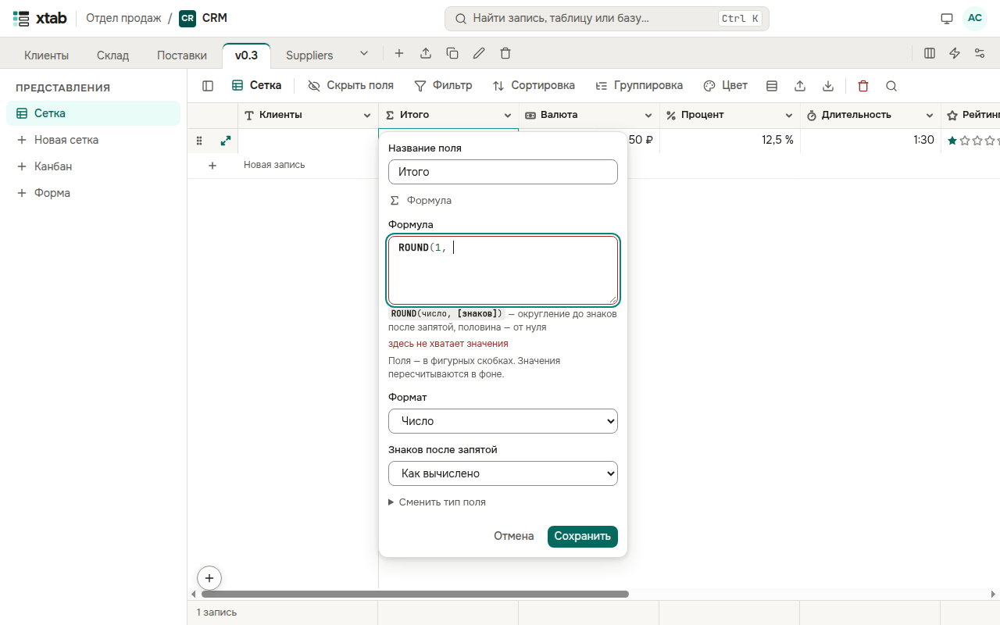
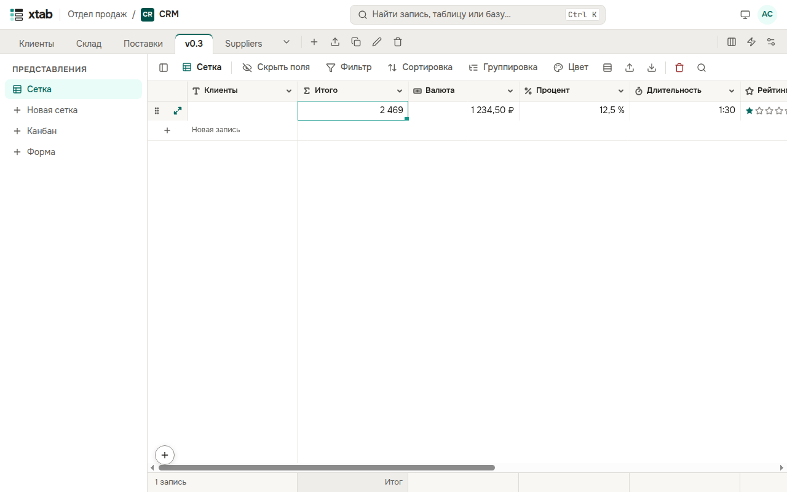
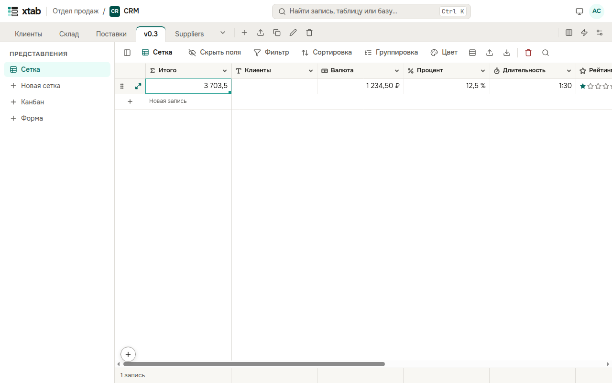

Поле **Формула** вычисляет значение из других полей записи, например `{Цена} * {Количество}`.

1. Добавьте поле типа **Формула** и наберите формулу. Названия полей пишутся в фигурных скобках.
2. После `{` xtab предлагает поля, а когда вы начинаете писать название функции — подходящие функции. Выберите стрелками и нажмите Enter.

   

3. Ошибка подчёркивается сразу, под формулой объясняется, что не так.

   

4. Пока вы пишете функцию, под формулой видно, какие у неё аргументы и что она делает.

   

5. Строка **На выбранной записи:** показывает, что получится на текущей записи.
6. Нажмите **Создать поле**.

Значения формулы пересчитываются сами, когда меняются поля, от которых она зависит. В большой таблице пересчёт идёт в фоне — за это время значения ещё раз обновятся на глазах.

Если формула, подстановка или сводка даёт число, в окне **Изменить поле** можно выбрать, как его показывать: **Формат** — **Число**, **Валюта** или **Процент**, и **Знаков после запятой** — тогда у всех значений одинаковое число знаков (**Как вычислено** — сколько получилось). У валюты выберите валюту и, если нужно, снимите **Показывать знак валюты**. Процент показывает долю: `0,5` — это 50 %. Итоги под колонкой берут тот же формат. У формулы строка **На выбранной записи:** в этом окне сразу показывает значение в выбранном формате. Это только вид: значения, фильтры, сортировка и экспорт не меняются.

Функции — как в Excel и Airtable: `IF`, `ROUND`, `SUM`, `CONCATENATE`, `DATEADD`, `WORKDAY`, `ARRAYJOIN`, `REGEX_MATCH` и другие. Все функции с примерами — в разделе «Справочник функций формул» ниже.

По результату формулы можно фильтровать, сортировать, группировать и считать итоги. Формулу можно сделать первичным полем — тогда записи называются её значением.

