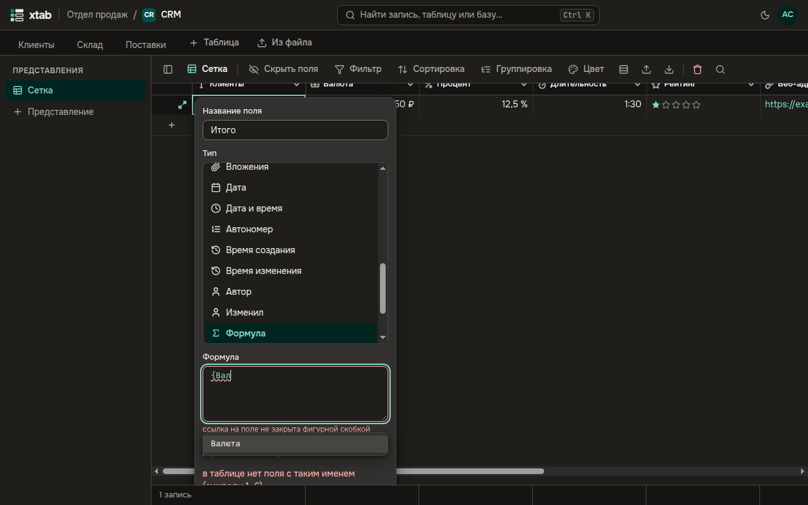
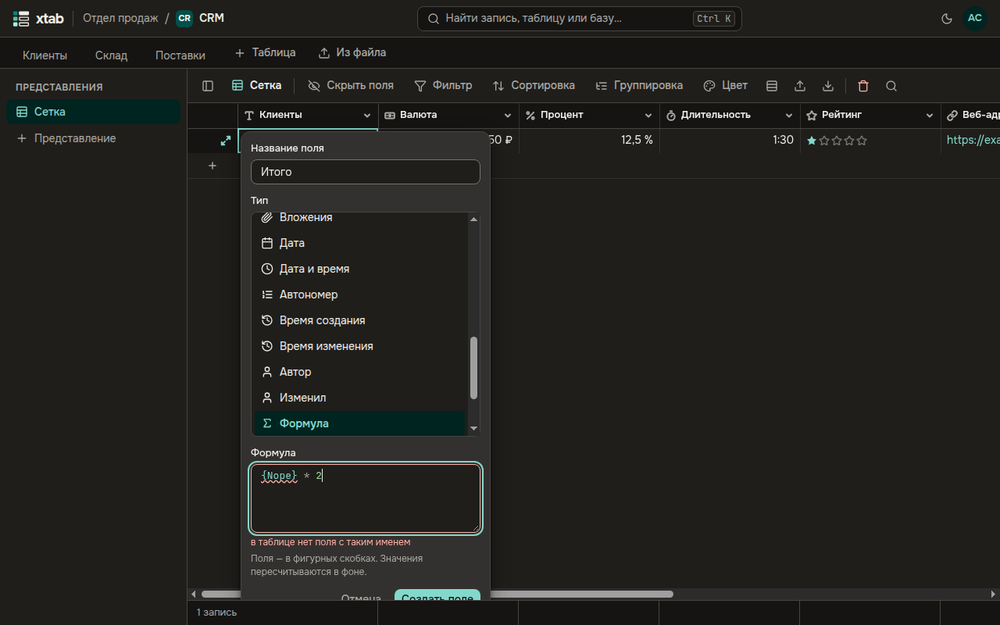
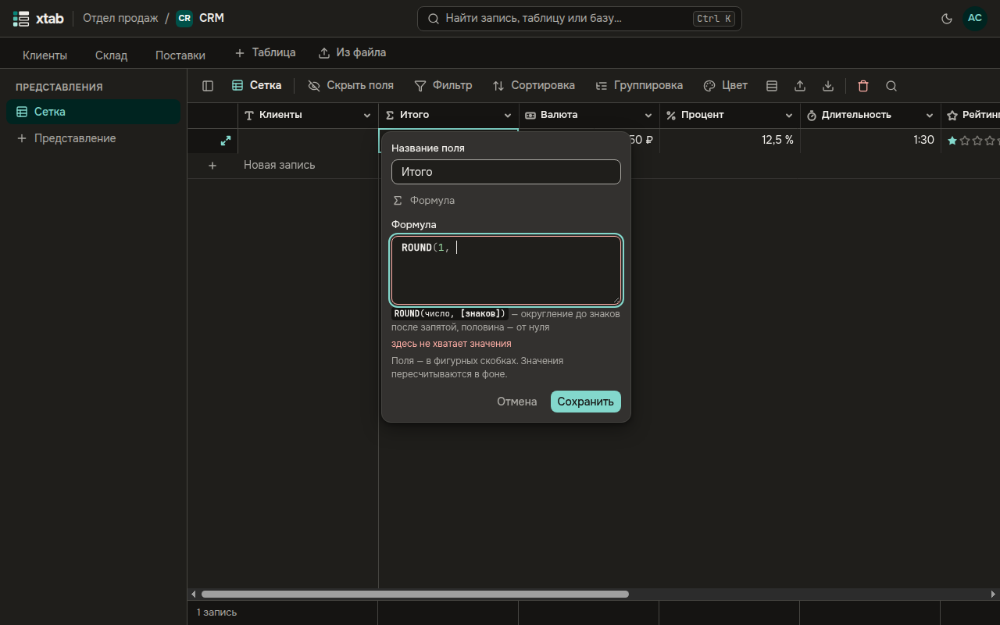
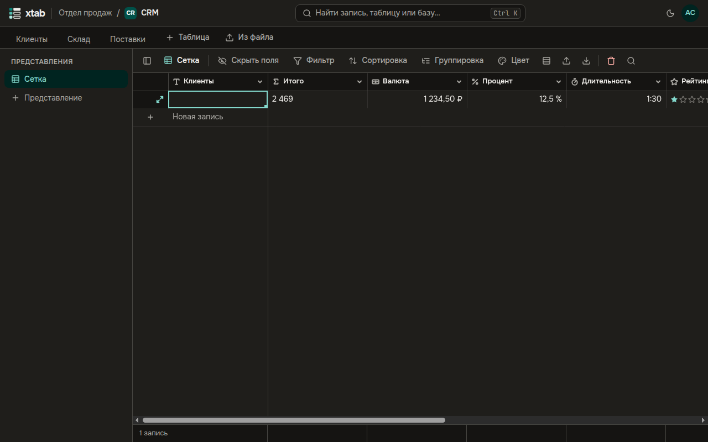
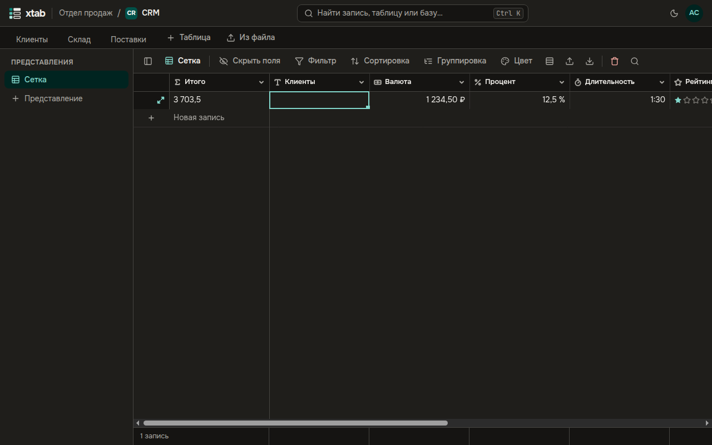

Поле **Формула** вычисляет значение из других полей записи, например `{Цена} * {Количество}`.

1. Добавьте поле типа **Формула** и наберите формулу. Названия полей пишутся в фигурных скобках.
2. После `{` xtab предлагает поля, а когда вы начинаете писать название функции — подходящие функции. Выберите стрелками и нажмите Enter.

   

3. Ошибка подчёркивается сразу, под формулой объясняется, что не так.

   

4. Пока вы пишете функцию, под формулой видно, какие у неё аргументы и что она делает.

   

5. Строка **На выбранной записи:** показывает, что получится на текущей записи.
6. Нажмите **Создать поле**.

Значения формулы пересчитываются сами, когда меняются поля, от которых она зависит. В большой таблице пересчёт идёт в фоне — за это время значения ещё раз обновятся на глазах.

Функции — как в Excel и Airtable:

- арифметика и округление: `ROUND`, `SUM`, `AVERAGE`;
- условия: `IF`, `SWITCH`, `AND`, `OR`;
- текст: `CONCATENATE`, `LEFT`, `UPPER`, `SUBSTITUTE`;
- даты с часовым поясом организации: `TODAY`, `DATEADD`, `DATETIME_DIFF`, `DATETIME_FORMAT`, `WORKDAY`;
- списки: `ARRAYJOIN`, `ARRAYUNIQUE`;
- регулярные выражения: `REGEX_MATCH`.

По результату формулы можно фильтровать, сортировать, группировать и считать итоги. Формулу можно сделать первичным полем — тогда записи называются её значением.

