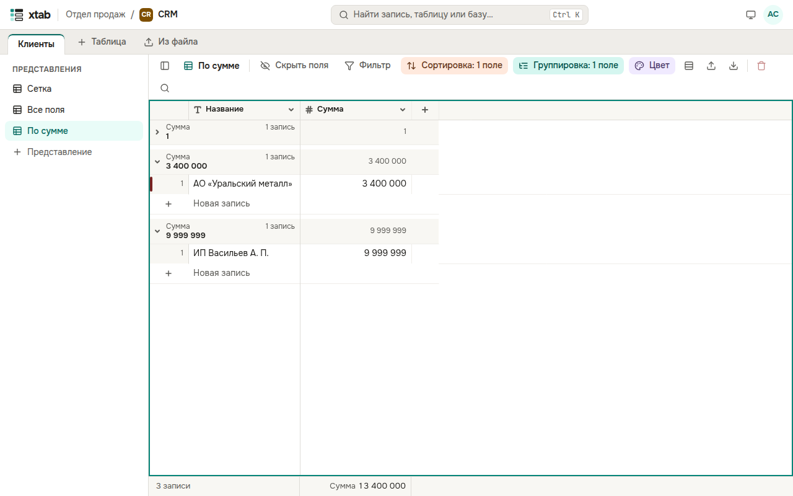

Нажмите **Группировка** над таблицей, затем **Добавить группировку** и выберите поле: записи с одинаковым значением собираются в группу с заголовком и числом записей. Можно группировать по нескольким полям.

- Нажмите стрелку в заголовке группы, чтобы свернуть или развернуть её; **Свернуть все** и **Развернуть все** — в панели группировки.
- Строка **Новая запись** внизу группы добавляет запись сразу с её значением.
