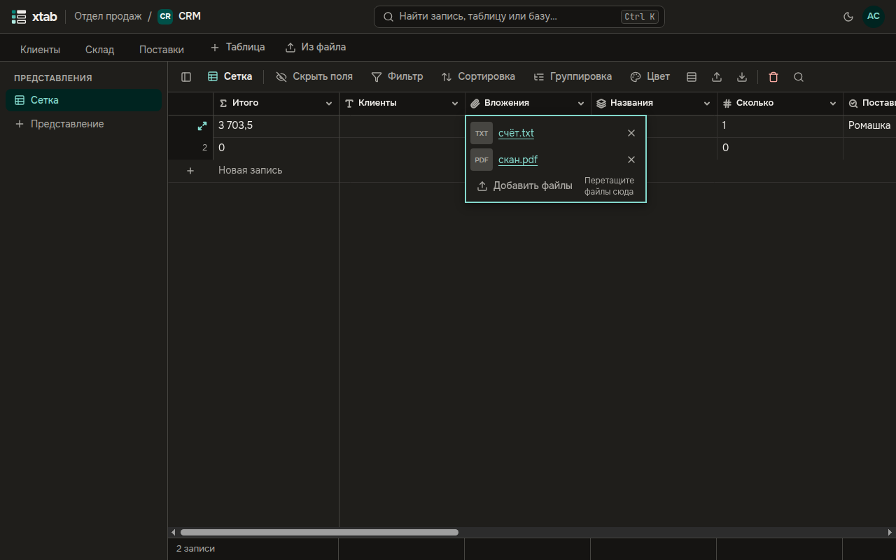
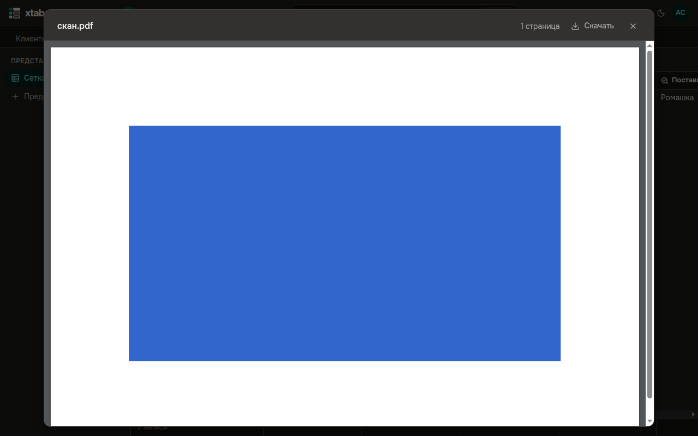

В поле **Вложения** хранятся файлы: договоры, сканы, фотографии.

- **Добавить файлы:** выберите ячейку и нажмите Enter, затем **Добавить файлы** — или перетащите файлы в окно ячейки. В одной ячейке — до 100 файлов.
- **Открыть файл:** нажмите на его имя:
  - картинки, видео и звук открываются в новой вкладке;
  - PDF — в окне просмотра прямо в xtab;
  - остальные файлы скачиваются.
- **Убрать файл:** нажмите крестик справа от имени. Если файл убран по ошибке, отмените действие (Ctrl+Z) — файл вернётся.

Для картинок xtab делает миниатюры, и они видны прямо в таблице. Из фотографий при загрузке удаляются сведения о месте съёмки, камере и авторе.

В окне просмотра PDF:

- страницы листаются прокруткой;
- вверху видно число страниц и кнопка **Скачать**;
- Esc или крестик закрывают окно.

Документ, защищённый паролем, нужно скачать, чтобы открыть.

