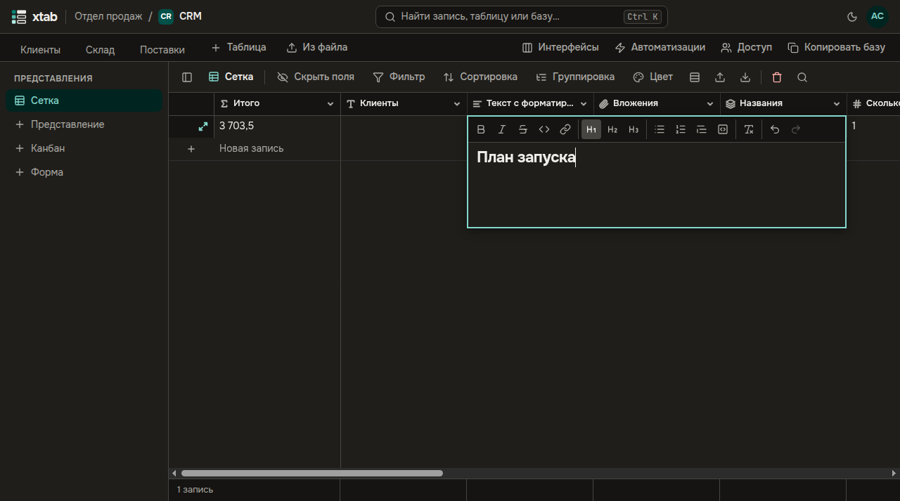

Поле **Длинный текст с форматированием** хранит заметки, описания и инструкции с заголовками, списками, ссылками и цитатами.

- **Править:** выберите ячейку и нажмите Enter или дважды щёлкните по ней — откроется редактор. Кнопки вверху: заголовки, жирный, курсив, зачёркнутый, код, ссылка, списки, цитата, блок кода, очистка оформления, отмена и повтор.
- **Сохранить** — Ctrl+Enter или Tab (Tab ещё и переходит к следующей ячейке); **отменить правку** — Esc.
- Ссылки — только на адреса `http://`, `https://` и `mailto:`.
- Текст из Word, браузера или почты вставляется с заголовками, списками и ссылками; остальное оформление убирается.
- В таблице видно начало текста без оформления, целиком — в окне записи.
- Поиск, фильтры и формулы работают с текстом без оформления; при экспорте поле выгружается разметкой Markdown.

