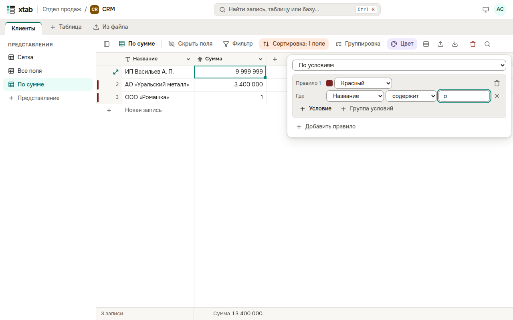

Нажмите **Цвет** над таблицей и выберите, как раскрашивать записи:

- **По полю одиночного выбора** — полоса слева от записи окрашивается в цвет её варианта;
- **По условиям** — задайте правило: цвет и условия, как в фильтре. **Добавить правило** — ещё одно; запись получает цвет первого подошедшего правила.

