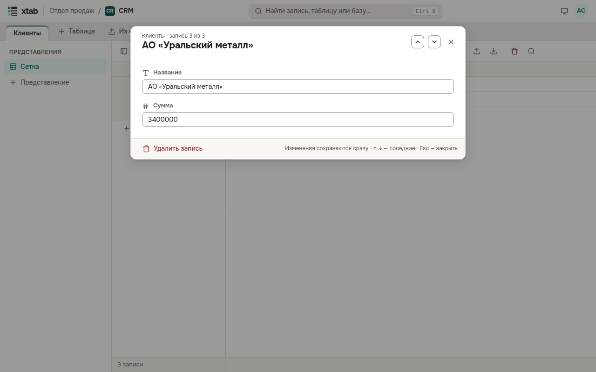

Чтобы увидеть все поля одной записи сразу, выберите её ячейку и нажмите пробел или нажмите на номер строки слева.

- Измените любое поле: значение сохраняется, как только вы уходите из поля или выбираете вариант.
- Стрелки ↑ и ↓ (или кнопки вверху) открывают соседние записи.
- Esc или крестик закрывают окно.
