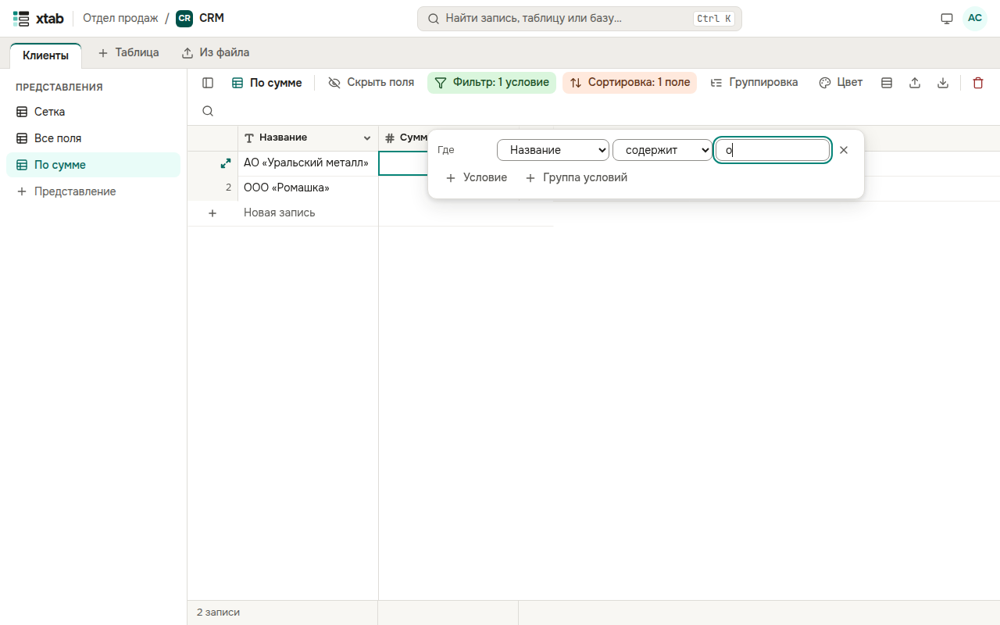

Фильтр оставляет в представлении только подходящие записи. Нажмите **Фильтр** над таблицей и затем **+ Условие**: выберите поле, условие (например, «содержит», «больше», «сегодня») и значение. Несколько условий связываются словами «и» или «или»; **+ Группа условий** объединяет условия в скобки.

Кнопка подсвечивается и показывает число условий. Чтобы убрать условие, нажмите крестик справа от него.
