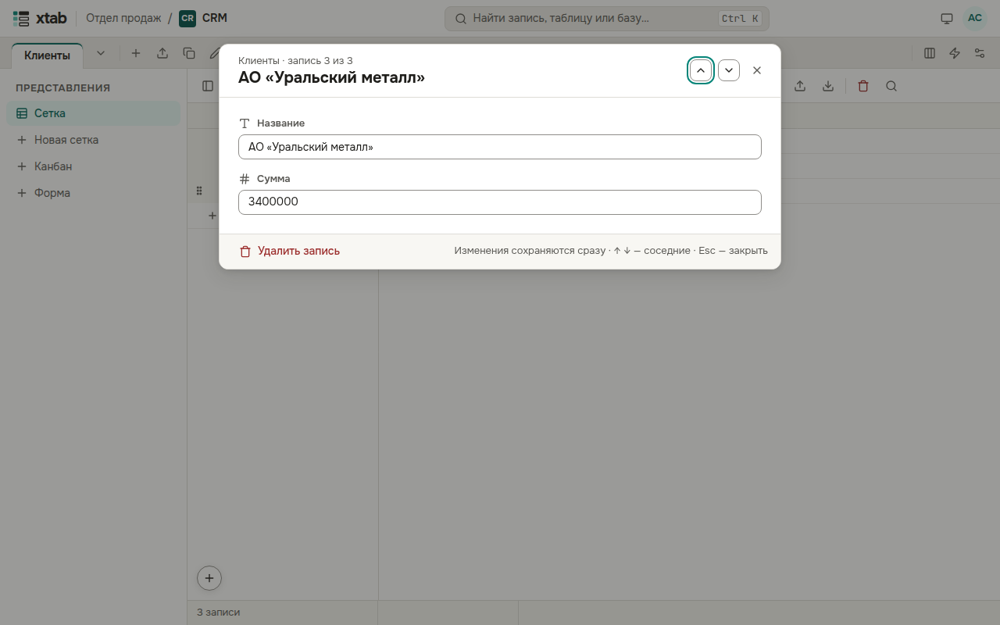

Чтобы увидеть все поля одной записи сразу, выберите её ячейку и нажмите пробел или нажмите на номер строки слева.

- Измените любое поле: значение сохраняется, как только вы уходите из поля или выбираете вариант.
- Файлы поля **Вложения** — те же, что в ячейке: их можно открыть, добавить кнопкой **Добавить файлы** или перетаскиванием и убрать крестиком.
- Стрелки ↑ и ↓ (или кнопки вверху) открывают соседние записи.
- Esc или крестик закрывают окно.
