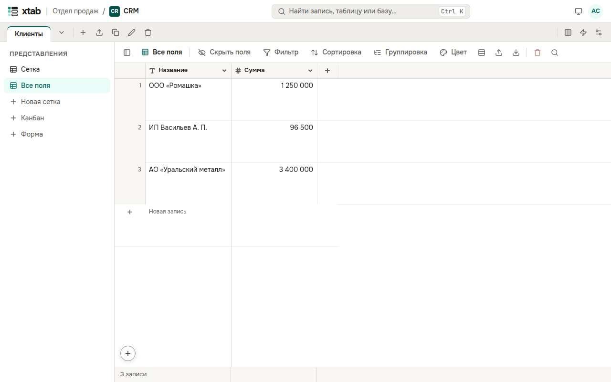

Представление — это способ смотреть на таблицу: какие поля видны, в каком порядке и какой ширины колонки, какие записи отобраны, как они отсортированы, сгруппированы и раскрашены. У одной таблицы может быть много представлений, данные у них общие. Список представлений — слева от таблицы; кнопка с панелью в начале строки над таблицей прячет и показывает его.

- **Новая сетка:** нажмите **+ Новая сетка** в списке слева, введите название и нажмите Enter. В новом представлении видны все поля.
- **Переименовать, дублировать, удалить:** наведите указатель на представление в списке и нажмите карандаш, значок копии или корзину. Последнее представление таблицы удалить нельзя.
- **Порядок представлений:** перетащите представление в списке на новое место или, перейдя на него клавишей Tab, нажимайте Alt+↑ или Alt+↓. Порядок общий для всех и сразу меняется у других; менять его могут создатель и владелец базы. Новое представление и дубликат встают в конец списка.
- **Скрыть поля:** нажмите **Скрыть поля** над таблицей и выключите ненужные поля; **Скрыть все** и **Показать все** — разом.
- **Высота строк:** нажмите значок строк над таблицей и выберите **Низкие**, **Средние** или **Высокие**.
- **Ширина колонки:** потяните за правый край заголовка колонки.

Каждое представление помнит свои настройки. Все, кто открывает представление, видят его одинаково.

Таблица открывается в представлении, которое вы выбрали в ней последним, — и при переходе по вкладке, и после перезагрузки страницы. Это запоминается для вас в этом браузере и на порядок представлений у других не влияет. В адресной строке — адрес показанного представления: ссылка из неё откроет коллеге то же представление. Если запомненное представление удалили, открывается первое.

На узком экране, например на телефоне, список представлений сначала скрыт, чтобы таблица занимала весь экран; кнопка с панелью открывает его поверх таблицы, а закрывают выбор представления, клавиша Esc, нажатие мимо списка или кнопка с крестиком **Скрыть представления** в нём.
