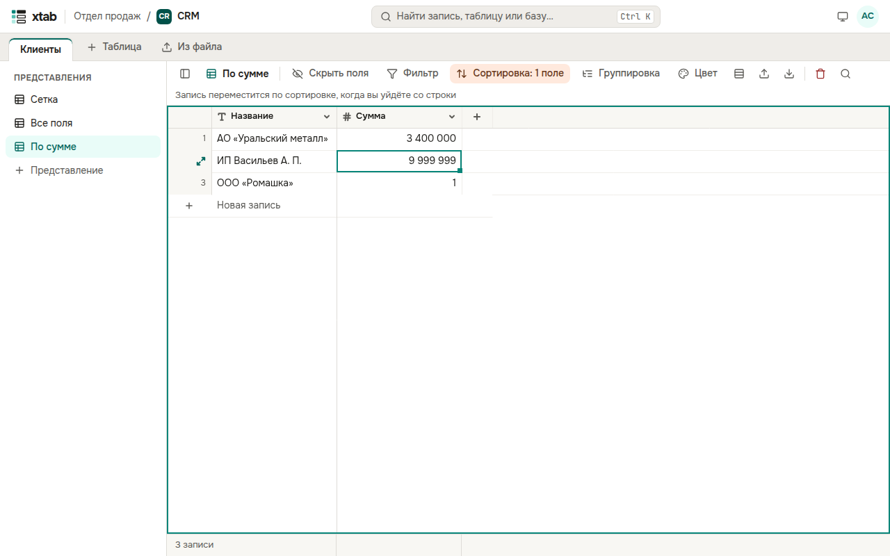

Нажмите **Сортировка** над таблицей, затем **Добавить сортировку**, выберите поле и направление. Вторая и следующие сортировки упорядочивают записи с одинаковыми значениями первой. Без сортировки записи идут в ручном порядке — как их добавили.

Если вы изменили значение и запись должна переместиться по сортировке или пропасть по фильтру, она остаётся на месте, пока вы не уйдёте со строки, — об этом напоминает подсказка над таблицей.

Если у вас нет права менять представление, фильтр и сортировку всё равно можно задать: их видите только вы, и они сбрасываются при обновлении страницы. Над таблицей тогда видна надпись **Временные фильтр и сортировка** с кнопкой **Сбросить**.
