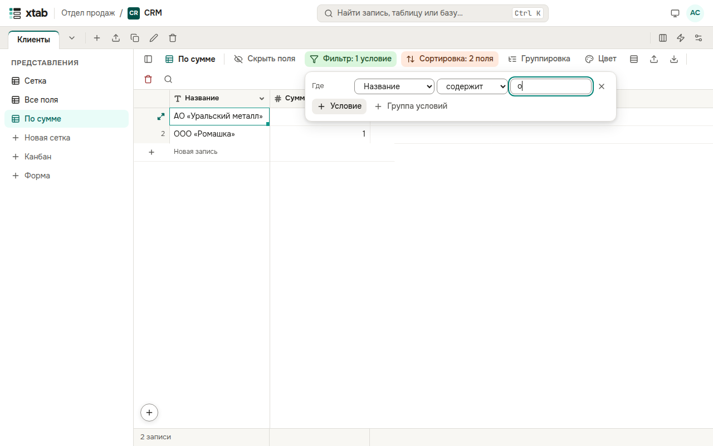

Фильтр оставляет в представлении только подходящие записи. Нажмите **Фильтр** над таблицей и затем **+ Условие**: выберите поле, условие (например, «содержит», «больше», «сегодня») и значение. Несколько условий связываются словами «и» или «или»; **+ Группа условий** объединяет условия в скобки.

Кнопка подсвечивается и показывает число условий. Чтобы убрать условие, нажмите крестик справа от него.

Новая запись в отфильтрованном представлении — кнопкой **+**, строкой **Новая запись**, клавишами Shift+Enter или вставкой строк ниже последней — сразу получает значения из фильтра, чтобы остаться в представлении. Например, при фильтре «Цвет — Зелёный» в новой записи поле **Цвет** будет **Зелёный**. Значение подставляется, только когда фильтр не оставляет выбора: условие «равно» (или «я» для поля пользователя), флажок, «любой из» с одним вариантом, «содержит все» и «ровно» для множественного выбора и нескольких пользователей. Условия, которым подходит много значений («содержит», «больше», «не равно», «не пусто», даты «сегодня» и периоды), условия внутри группы «или», условия по связям, датам со временем и вычисляемым полям, а также два условия с разными значениями для одного поля ничего не подставляют. Так же работает временный фильтр.
