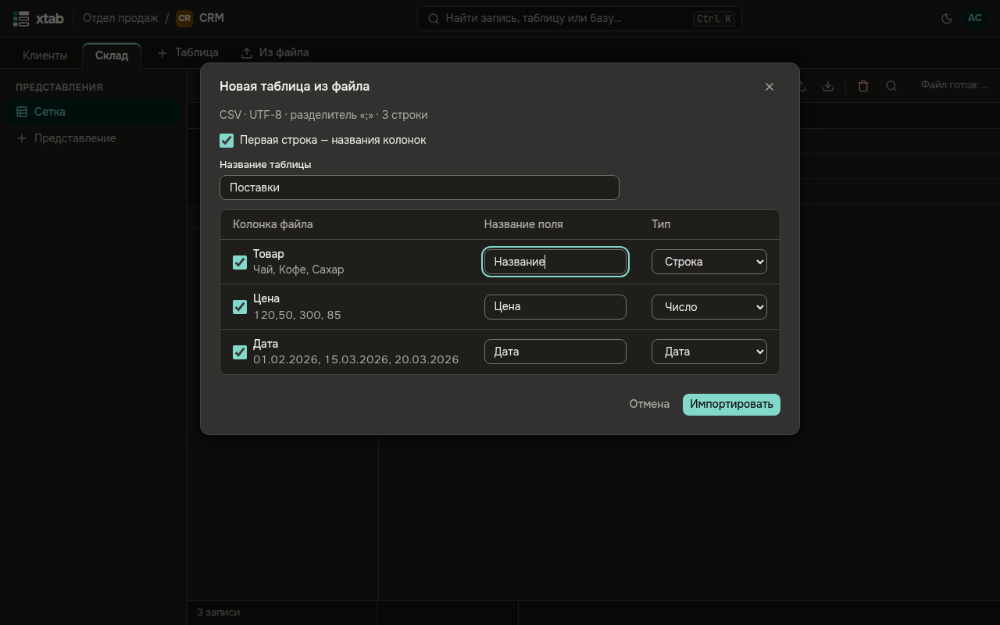

Подходят файлы CSV и XLSX до 50 МБ; кодировку и разделитель CSV xtab определяет сам.

- **Новая таблица из файла:** нажмите **Из файла** справа от вкладок таблиц.
- **Записи в эту таблицу:** нажмите значок со стрелкой вверх над таблицей.

Перетащите файл в окно или нажмите **Выбрать файл**. xtab покажет колонки файла с примерами значений и предложит поле и тип для каждой. Снимите флажок у колонки, которую не нужно загружать, поправьте названия и типы и нажмите **Импортировать**.

- Окно можно закрыть — импорт продолжится; его ход виден над таблицей.
- Если многие значения не подходят к полям, импорт остановится и покажет примеры: **Всё равно импортировать** или **Не импортировать**. **Скачать отчёт** — файл со всеми строками, которые не подошли.
- **Удалить записи импорта** — в течение суток после импорта: убирает добавленные им записи. Записи, которые с тех пор изменили, можно оставить.
