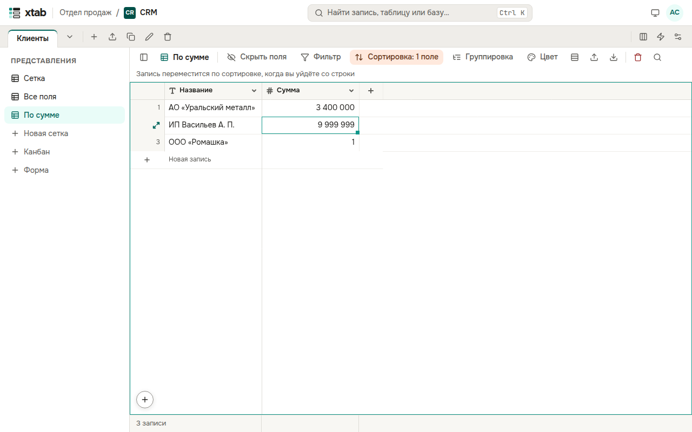

Нажмите **Сортировка** над таблицей, затем **Добавить сортировку**, выберите поле и направление. Вторая и следующие сортировки упорядочивают записи с одинаковыми значениями первой. Без сортировки записи идут в ручном порядке — как их добавили или переставили.

## Ручной порядок записей

В представлении без сортировки записи можно переставлять:

- **Перетащите строку за номер.** Наведите указатель на строку — вместо её номера появятся точки-ручка слева и значок открытия записи справа. Нажмите на номер и, не отпуская, перетащите строку: линия покажет, куда она встанет. Чтобы перенести несколько строк подряд, сначала выделите ячейки в этих строках (протяните выделение мышью или нажмите Shift со стрелками) и тяните за номер любой из них. Простое нажатие на номер, как и раньше, открывает запись.
- **С клавиатуры:** выберите ячейку записи и нажмите Alt+↑ или Alt+↓ — запись поднимется или опустится на одно место. То же делают пункты **Переместить выше** и **Переместить ниже** в меню правой кнопки мыши.
- **Отменить перестановку** можно, как и другие правки, — Ctrl+Z.

Ручной порядок один на всю таблицу: его видят все пользователи во всех представлениях этой таблицы без сортировки, и перестановку другие видят сразу. В сгруппированном представлении строки переставляются внутри своей группы. Если у представления есть сортировка (в том числе временная), порядок задаёт она: перетаскивание и Alt+↑/↓ не переставляют записи, а подсказка над таблицей предлагает убрать сортировку.

Если вы изменили значение и запись должна переместиться по сортировке или пропасть по фильтру, она остаётся на месте, пока вы не уйдёте со строки, — об этом напоминает подсказка над таблицей. Так же остаётся на месте новая запись — даже если она не подходит под фильтр (в том числе временный, поиск или фильтр элемента интерфейса) — и записи, в которые вы вставили или заполнили значения: они стоят на месте, пока выделение на них. Когда вы уходите со строки, записи встают на свои места, а выбранная ячейка остаётся на той записи, куда вы перешли. Пока строка стоит на месте, изменения других пользователей, которые добавляют, убирают или переставляют записи, появятся, когда вы уйдёте со строки; новые значения в видимых ячейках показываются сразу.

Если у вас нет права менять представление, фильтр и сортировку всё равно можно задать: их видите только вы, и они сбрасываются при обновлении страницы. Над таблицей тогда видна надпись **Временные фильтр и сортировка** с кнопкой **Сбросить**.
