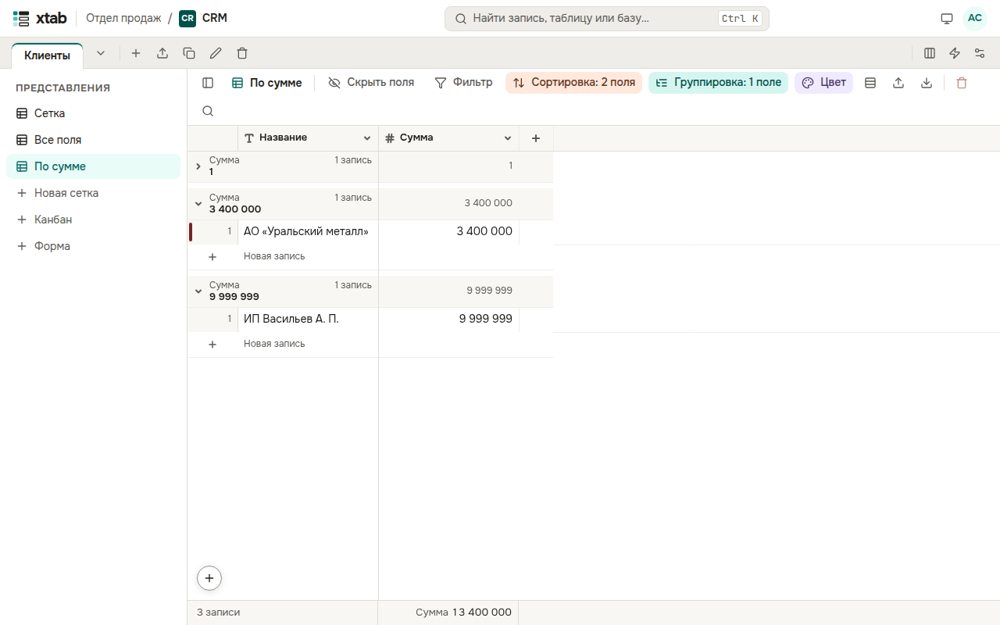

Нажмите **Группировка** над таблицей, затем **Добавить группировку** и выберите поле: записи с одинаковым значением собираются в группу с заголовком и числом записей. Можно группировать по нескольким полям.

- Нажмите стрелку в заголовке группы, чтобы свернуть или развернуть её; **Свернуть все** и **Развернуть все** — в панели группировки.
- Порядок групп задаёт направление уровня в панели группировки: **А → Я** или **Я → А** (у чисел — **1 → 9** или **9 → 1**, у дат — **Сначала старые** или **Сначала новые**, у выбора — **По порядку вариантов** или **В обратном порядке**). У поля **Связь** есть ещё **По порядку записей** — группы идут в том порядке, в котором записи стоят в связанной таблице: перетащите строки там (например, «Комплексный контракт» выше «Декор») — и группы во всех представлениях и интерфейсах перестроятся сами через секунду-две; под уровнем группировки подсказка называет эту таблицу. Если вы группируете только для себя (без права менять представление), группировка сбросится при перезагрузке, а новый порядок групп появится, когда вы снова выберете группировку. Группа из нескольких связанных записей встаёт по первой из них, затем по следующим; группа без связей — последней.
- Строка **Новая запись** внизу группы добавляет запись сразу с её значением (поверх значений фильтра) — и в группе по связи, с теми же связанными записями; запись появляется в конце группы и остаётся там, пока вы на ней. Исключение — группа по полю **Дата и время**: она собирает записи одного дня, и время новой записи не подставляется.
- Если вы изменили значение поля группировки — в редакторе ячейки, вставкой или заполнением, — запись остаётся в прежней группе с подсказкой «Запись перейдёт в другую группу, когда вы уйдёте со строки». Когда вы уходите со строки, запись переходит в новую группу, а числа записей в заголовках пересчитываются.
