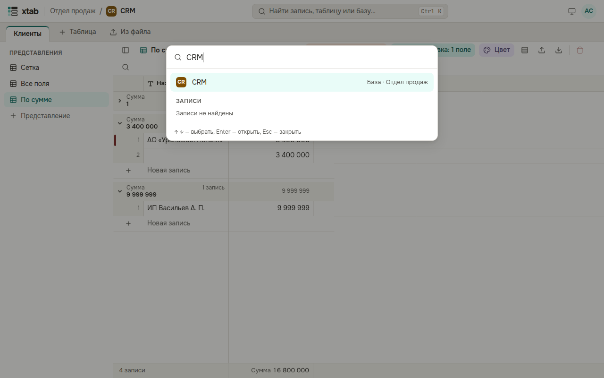
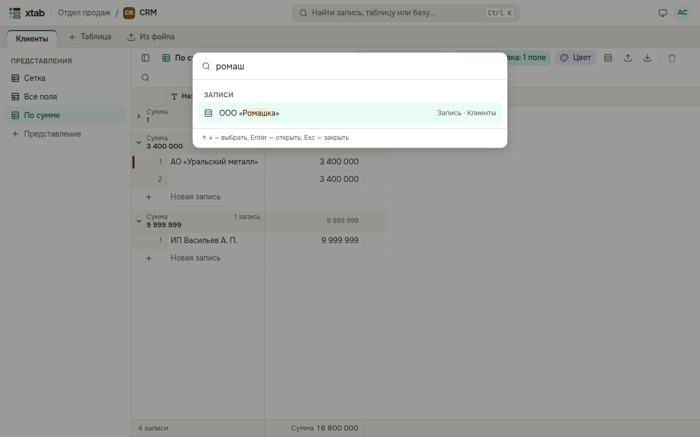

Нажмите Ctrl+K (на Mac — ⌘K) или поле **Найти запись, таблицу или базу…** вверху. Начните вводить название базы, таблицы или текст записи, выберите результат стрелками и нажмите Enter.

Найденная запись открывается целиком в своей таблице.

