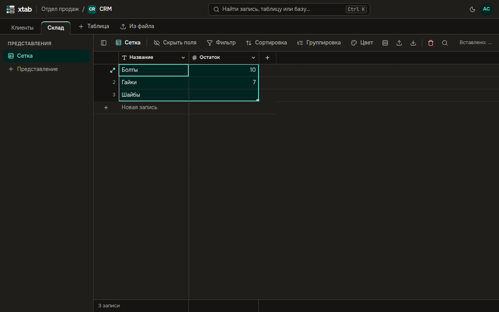

- **Выделить диапазон:** протяните мышью по ячейкам или нажмите стрелки с Shift; Ctrl+A выделяет все ячейки представления.
- **Копировать и вставить:** Ctrl+C, Ctrl+X и Ctrl+V — в том числе из Excel и Google Таблиц и обратно. Если вставляемых строк больше, чем записей ниже, недостающие записи добавляются. Над таблицей видно, сколько значений вставлено и какие не подошли к полям.
- **Заполнить вниз:** потяните за квадратик в правом нижнем углу выделения или нажмите Ctrl+D — значения верхней строки копируются вниз.
- **Очистить ячейки:** Delete.
- **Меню диапазона:** нажмите правой кнопкой по выделению — копировать, вырезать, заполнить вниз, очистить ячейки, удалить записи.

