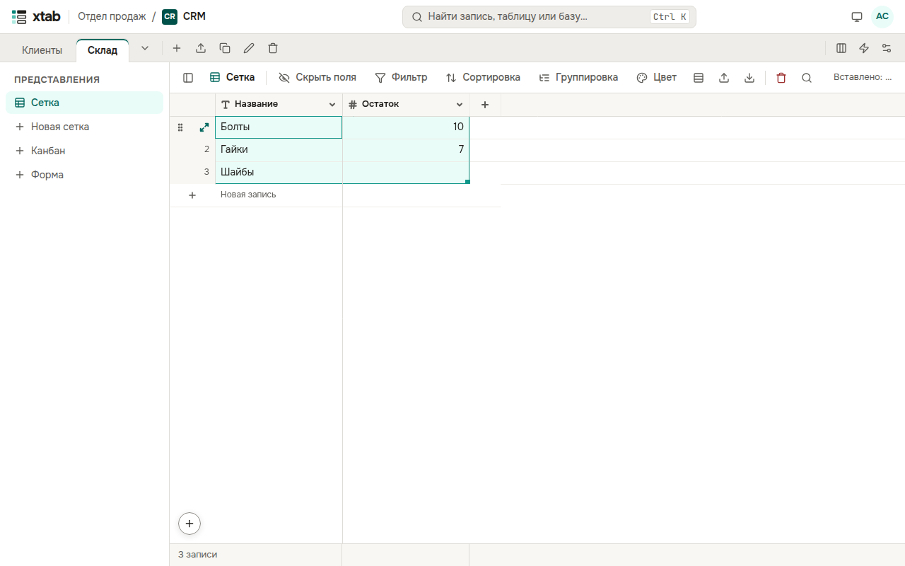

- **Выделить диапазон:** протяните мышью по ячейкам или нажмите стрелки с Shift; Ctrl+A выделяет все ячейки представления.
- **Копировать и вставить:** Ctrl+C, Ctrl+X и Ctrl+V — в том числе из Excel и Google Таблиц и обратно. Если вставляемых строк больше, чем записей ниже, недостающие записи добавляются. Над таблицей видно, сколько значений вставлено и какие не подошли к полям.
- **Заполнить вниз** (Ctrl+D или пункт меню правой кнопки): выделено несколько строк — значения верхней строки выделения копируются во все строки ниже неё; выделена одна ячейка или одна строка — в неё копируется значение записи над ней. В первой строке таблицы заполнять нечего: пункт меню неактивен, а Ctrl+D подскажет «Нечего заполнять: выделите несколько строк». В сгруппированной таблице значение берётся только из той же группы: первая запись группы не получит значение из соседней. Связи копируются со всеми связанными записями; вложения не копируются — файл принадлежит одной ячейке, об этом скажет строка состояния.
- **Маркер заполнения:** потяните за квадратик в правом нижнем углу выделения вниз — верхняя строка выделения скопируется во все строки до места, где вы отпустили кнопку мыши.
- **Очистить ячейки:** Delete.
- **После вставки, заполнения и очистки** выделение остаётся на тех же записях. Если записи должны перейти в другую группу или переместиться по сортировке, они стоят на месте с подсказкой над таблицей, пока выделение на них; когда вы уходите с них, записи встают на свои места.
- **Меню диапазона:** нажмите правой кнопкой по выделению или по номеру строки (выделится вся строка) — копировать, вырезать, заполнить вниз, очистить ячейки, удалить записи. С клавиатуры — Shift+F10 или клавиша меню на выбранной ячейке. Вставка — только клавишами Ctrl+V: браузер не даёт странице читать буфер обмена, поэтому пункт **Вставить** в меню неактивен.

