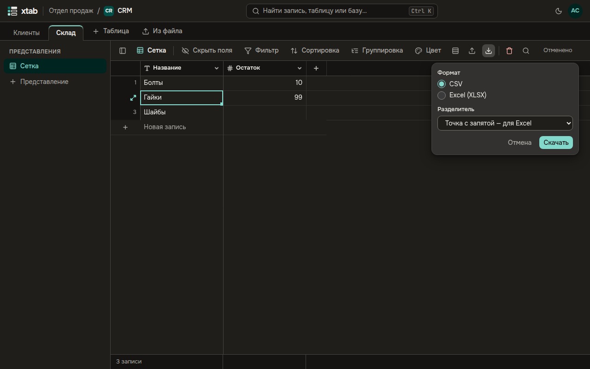

Нажмите значок со стрелкой вниз над таблицей, выберите формат — **CSV** или **Excel (XLSX)** — и для CSV разделитель, затем **Скачать**. В файл попадают записи и поля представления с его фильтром и сортировкой. Если записей больше 1000, xtab попросит ещё раз ввести пароль.

