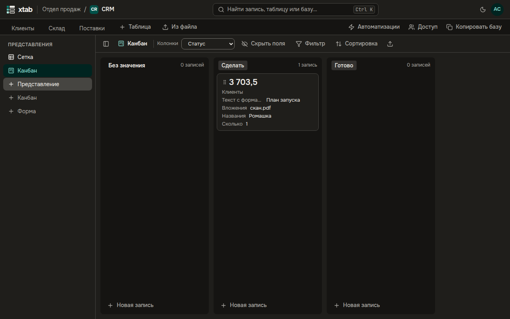

Канбан показывает записи карточками в колонках — по полю одиночного выбора или пользователя. Удобен для задач, заявок и сделок по стадиям.

- **Создать:** нажмите **+ Канбан** в списке представлений слева, введите название и нажмите Enter, затем выберите поле в списке **Колонки**.
- Колонка — на каждый вариант поля и **Без значения**; в заголовке колонки — число карточек.
- На карточке — первичное поле и следующие поля таблицы; лишние уберите кнопкой **Скрыть поля** над канбаном. Фильтр и сортировка работают так же, как в таблице.
- **Перенести карточку** — перетащите её мышью или пальцем в другую колонку или на другое место: значение поля меняется само. С клавиатуры — выберите карточку и нажмите Alt со стрелкой.
- **Открыть запись** — нажмите на карточку или Enter.
- **Новая запись** внизу колонки создаёт запись сразу с её значением.

