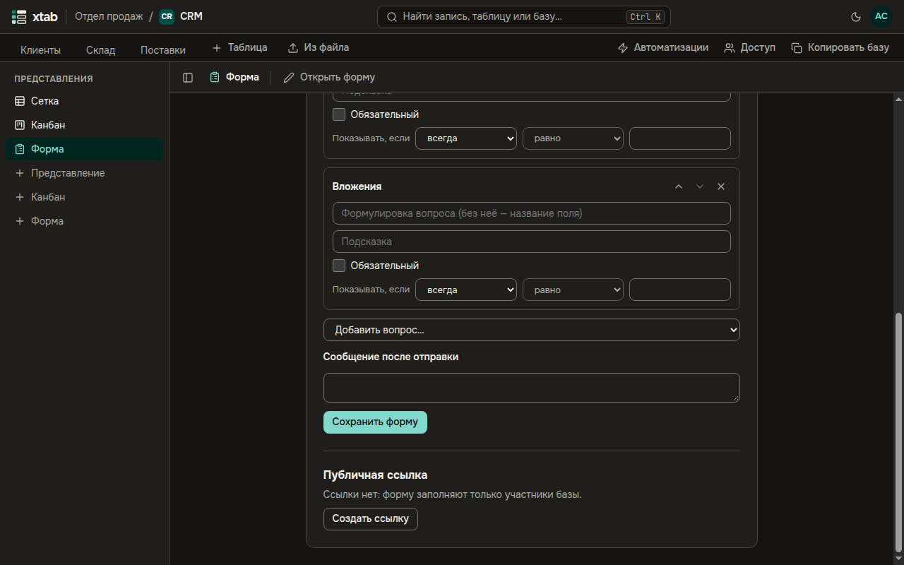
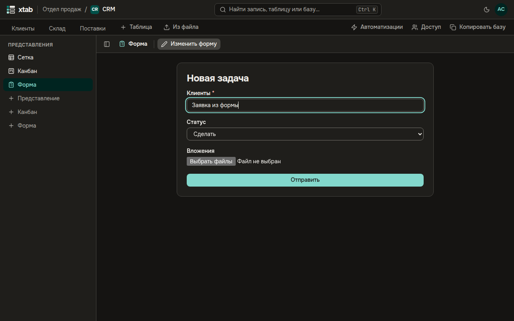
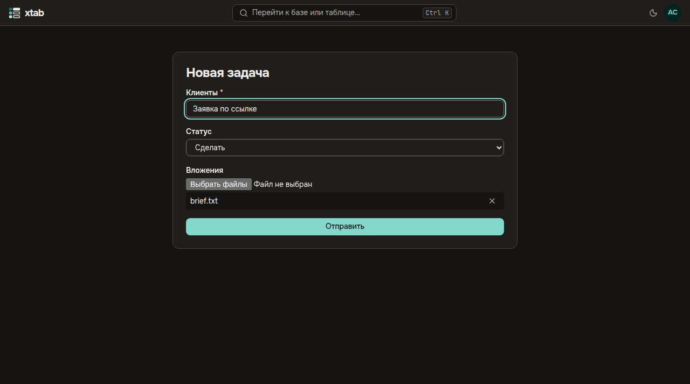

Форма собирает записи в таблицу: участники базы заполняют её в xtab, а по публичной ссылке — кто угодно, без входа.

- **Создать:** нажмите **+ Форма** в списке представлений слева, введите название и нажмите Enter — откроется конструктор.
- В конструкторе задайте заголовок, описание и сообщение после отправки. **Добавить вопрос…** — выберите поле таблицы. У вопроса можно задать формулировку (без неё показывается название поля), подсказку, отметить **Обязательный** и задать условие **Показывать, если** — вопрос появится только при нужном ответе на один из предыдущих. **Выше**, **Ниже** и **Убрать вопрос** меняют порядок и состав. Нажмите **Сохранить форму**.
- В форму попадают поля, которые заполняются вручную: тексты, числа, выбор, флажок, даты, файлы и пользователи. Формулы, связи и системные поля не спрашиваются.

- **Открыть форму** — заполнить её самому, **Изменить форму** — вернуться в конструктор. После отправки появляется сообщение и кнопка **Отправить ещё**.

- **Публичная ссылка** — в конструкторе. **Создать ссылку**: ссылка показывается один раз, сразу скопируйте её. **Создать новую ссылку** заменяет прежнюю, **Отозвать ссылку** выключает форму для всех, у кого она была. Ссылкой управляет тот, кто может менять представления базы.
- По ссылке форму заполняют без входа. Вопросов о людях в публичной форме нет; к вопросу о файлах можно приложить до 5 файлов, каждый до 10 МБ. Перед отправкой браузер несколько секунд проверяет, что форму заполняет не робот.

