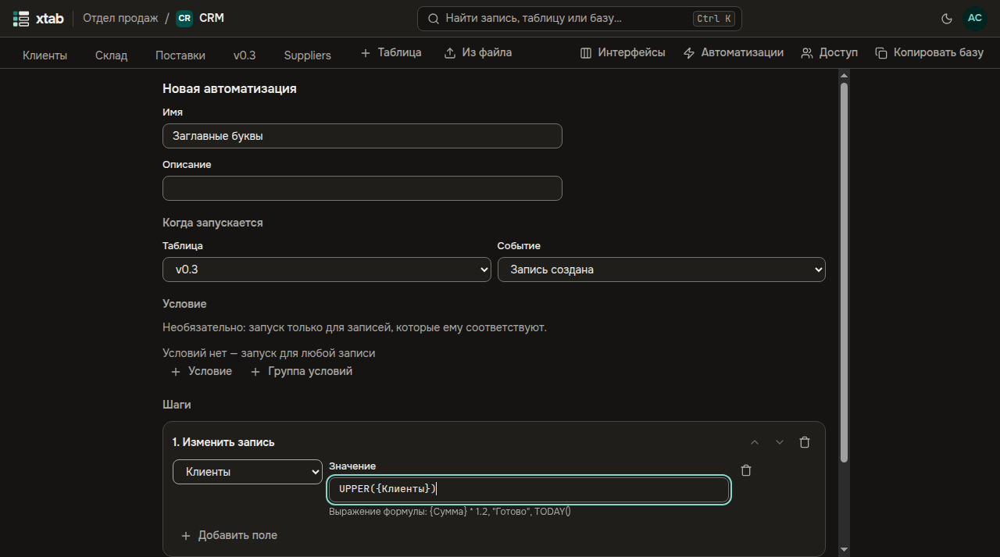
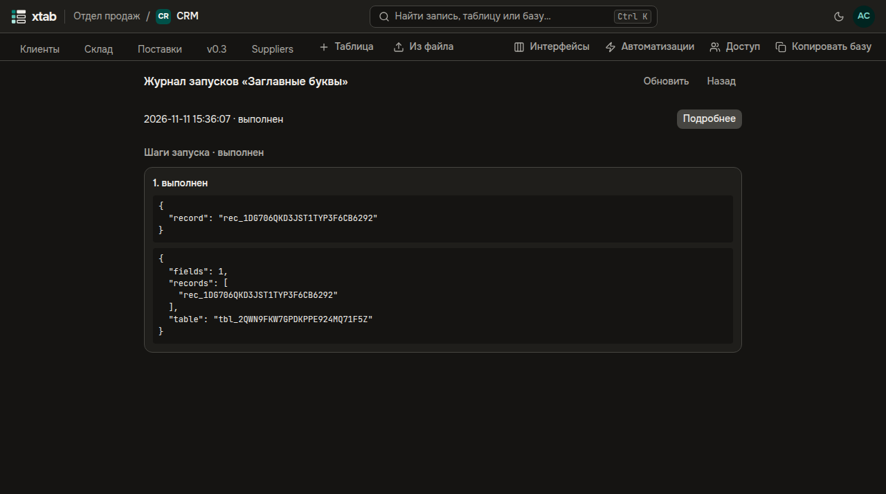

Автоматизация делает работу сама: когда запись создана, изменена, стала соответствовать условию или пришла из формы, она выполняет шаги — меняет запись, создаёт запись в другой таблице, отправляет письмо или HTTP-запрос во внешнюю систему. Создают и меняют автоматизации создатели базы; шаги выполняются правами того, кто автоматизацию создал.

- **Открыть:** кнопка **Автоматизации** в строке таблиц базы. Список показывает каждую автоматизацию, её событие, число шагов и состояние: **Включена**, **Выключена** или **Отключена системой** с причиной.
- **Новая автоматизация:** задайте имя, таблицу и событие. Для события **Запись изменена** отметьте поля, изменение которых её запускает; для **Отправлена форма** — выберите форму. **Условие** собирается так же, как фильтр представления; для события **Запись стала соответствовать условию** оно обязательно.

- **Шаги** добавляются кнопками под списком шагов и выполняются по порядку; стрелки меняют порядок, корзина убирает шаг.
  - **Изменить запись** и **Создать запись** — выберите поле и напишите значение формулой, например `UPPER({Название})` или `TODAY()`. Ошибка в формуле видна сразу под полем.
  - **Отправить письмо** — получатели из полей e-mail и пользователей записи и адреса через запятую, тема и текст со вставками `{{ {Поле} }}`. Письма уходят участникам организации, на домены приглашений и на адреса, которые разрешил администратор на странице **Исходящие адреса**.
  - **HTTP-запрос** — метод, адрес (узел пишется без вставок и должен быть разрешён на странице **Исходящие адреса**), заголовки, тело JSON со вставками, секрет подписи и Basic-аутентификация.
- **Секреты** — ключи внешних сервисов и пароли для HTTP-запросов. Они задаются внизу формы сохранённой автоматизации: значение шифруется и больше не показывается, его можно только заменить. В заголовке запроса выберите вид **Секрет** и укажите имя секрета.
- Новая автоматизация выключена: нажмите **Включить**. Если больше половины последних запусков закончились ошибкой или у владельца больше нет прав, система её отключает и пишет создателям базы.
- **Журнал** показывает запуски с результатом каждого шага. Неудачный запуск можно **Повторить** — выполненные шаги не повторяются. Если письмо или запрос могли дойти, но ответа не было, запуск получает исход **исход неизвестен**: проверьте получателя и нажмите **Повторить** или **Отметить выполненным**. Журнал хранит запуски 30 дней.

