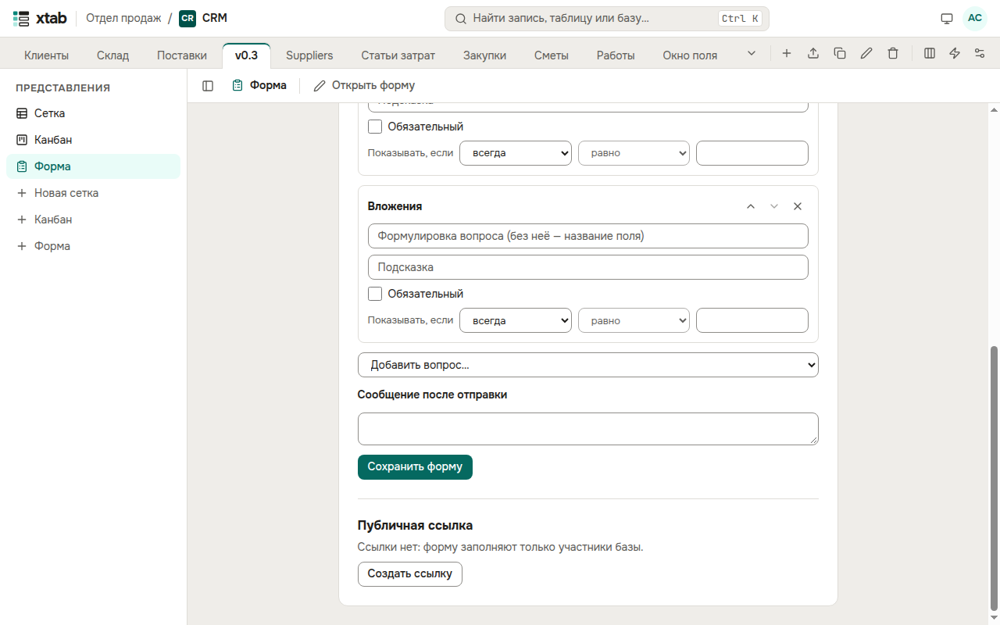
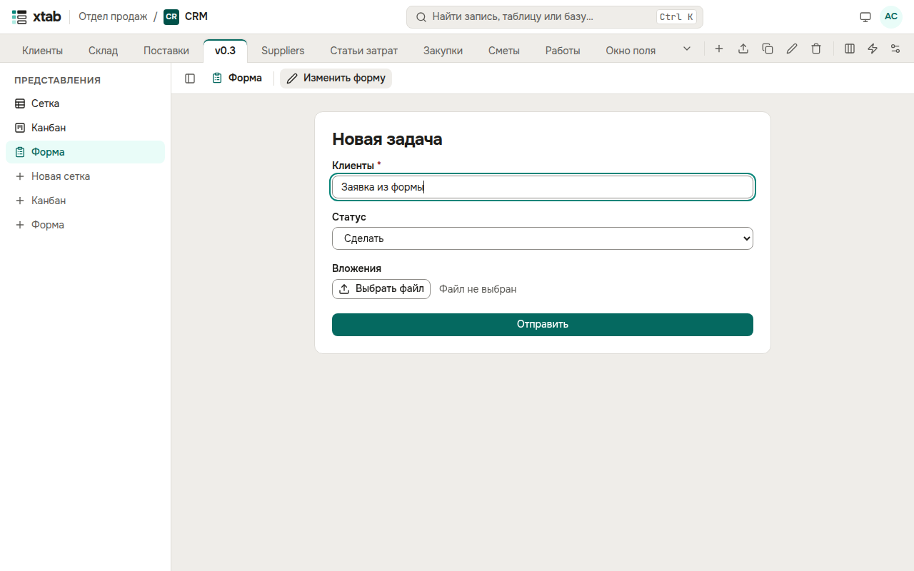
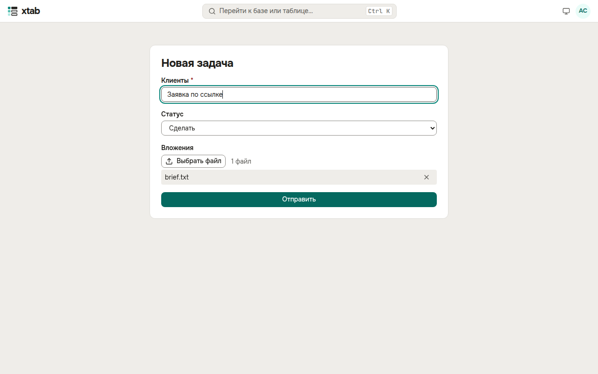

Форма собирает записи в таблицу: участники базы заполняют её в xtab, а по публичной ссылке — кто угодно, без входа.

- **Создать:** нажмите **+ Форма** в списке представлений слева, введите название и нажмите Enter — откроется конструктор.
- В конструкторе задайте заголовок, описание и сообщение после отправки. **Добавить вопрос…** — выберите поле таблицы. У вопроса можно задать формулировку (без неё показывается название поля), подсказку, отметить **Обязательный** и задать условие **Показывать, если** — вопрос появится только при нужном ответе на один из предыдущих. **Выше**, **Ниже** и **Убрать вопрос** меняют порядок и состав. Нажмите **Сохранить форму**.
- В форму попадают поля, которые заполняются вручную: тексты, числа, выбор, флажок, даты, файлы, пользователи и связи. Связь выбирают из записей связанной таблицы с учётом условия выбора поля и уже данных ответов. Формулы и системные поля не спрашиваются.

- **Открыть форму** — заполнить её самому, **Изменить форму** — вернуться в конструктор. После отправки появляется сообщение и кнопка **Отправить ещё**.
- Если вопросы формы или поля таблицы меняются, пока форма открыта, — вами в другой вкладке или другим человеком, — форма сразу показывает новые вопросы, обновлять страницу не нужно. Ответы на оставшиеся вопросы сохраняются, курсор остаётся в том же поле, а над вопросами появляется надпись **Форма изменена**; ответ на убранный вопрос пропадает, а если были выбраны файлы, надпись просит выбрать их заново. Если форма изменилась во время отправки, отправка доводится до конца, и изменённая форма показывает её итог — сообщение после отправки или ошибку; отправленные ответы второй раз не отправляются.

- **Публичная ссылка** — в конструкторе. **Создать ссылку**: ссылка показывается один раз, сразу скопируйте её. **Создать новую ссылку** заменяет прежнюю, **Отозвать ссылку** выключает форму для всех, у кого она была. Ссылкой управляет тот, кто может менять представления базы.
- По ссылке форму заполняют без входа. Вопросов о людях и связях в публичной форме нет; к вопросу о файлах можно приложить до 5 файлов, каждый до 10 МБ. Перед отправкой браузер несколько секунд проверяет, что форму заполняет не робот. Если подготовить проверку не удалось (нет связи, сервер перегружен), форма скажет, что пока не может принять ответы, — нажмите «Повторить»; введённые ответы при этом не теряются.

