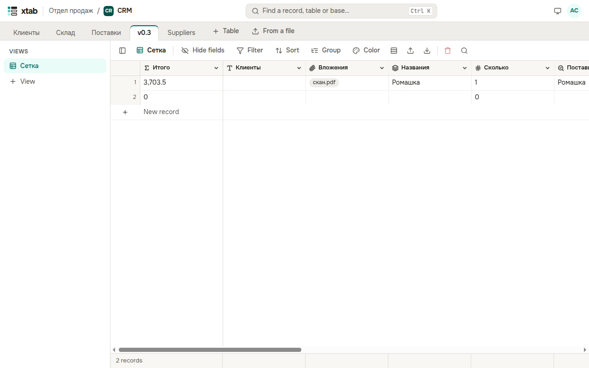

xtab говорит по-русски и по-английски. По умолчанию язык — как в браузере. Чтобы выбрать другой, нажмите на кружок с инициалами и выберите **Язык: русский**, **Язык: English** или **Язык: как в браузере**. Выбор запоминается в вашей учётной записи. Числа и даты в таблице записываются так, как принято в выбранном языке.

