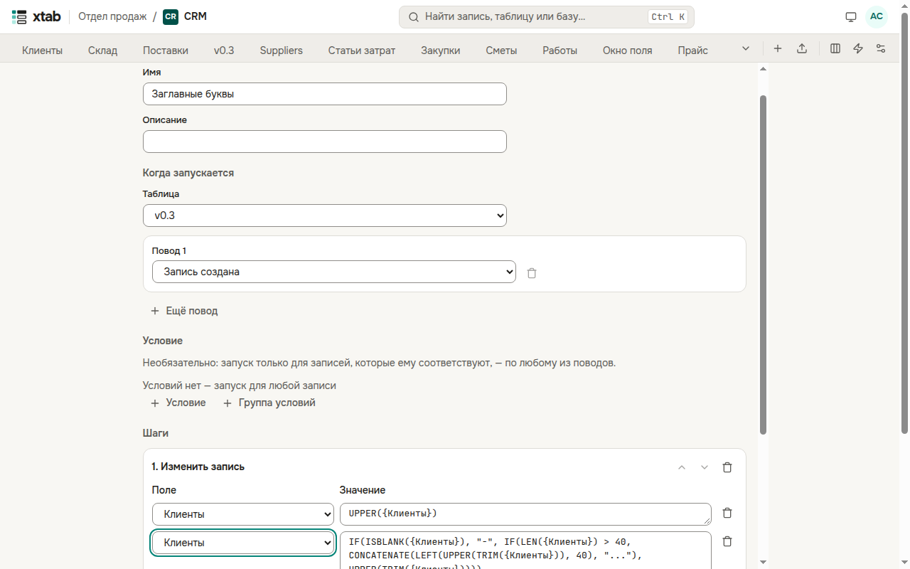
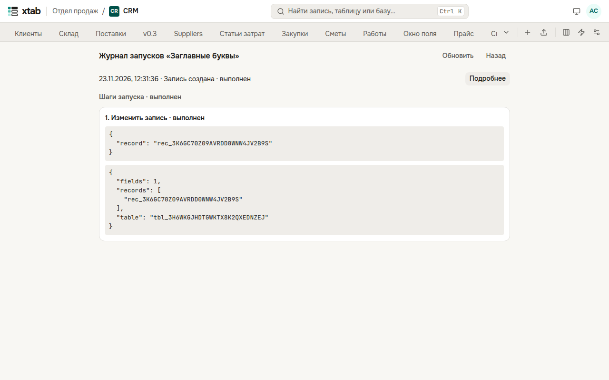

Автоматизация делает работу сама: по одному или нескольким поводам — запись создана, изменена, стала соответствовать условию, пришла из формы или в интерфейсе нажата кнопка — она выполняет шаги: меняет запись, создаёт запись в другой таблице, отправляет письмо или HTTP-запрос во внешнюю систему. Создают и меняют автоматизации создатели базы; шаги выполняются правами того, кто автоматизацию создал.

- **Открыть:** кнопка **Автоматизации** в строке таблиц базы. Список показывает каждую автоматизацию, её поводы, число шагов и состояние: **Включена**, **Выключена** или **Отключена системой** с причиной.
- **Новая автоматизация:** задайте имя, таблицу и повод. Для повода **Запись изменена** отметьте поля, изменение которых её запускает; для **Отправлена форма** — выберите форму; **Нажата кнопка в интерфейсе** запускает кнопка интерфейса с действием **Запустить автоматизацию**, в настройках которой выбрана эта автоматизация (см. «Интерфейсы»). **Условие** собирается так же, как фильтр представления; для повода **Запись стала соответствовать условию** оно обязательно.
- **Несколько поводов:** кнопка **Ещё повод** добавляет к автоматизации ещё один повод другого вида — всего до пяти, каждого вида не больше одного (поля **Запись изменена** отмечаются в одном поводе); корзина рядом с поводом убирает его, последний повод убрать нельзя. Автоматизация запускается по любому из поводов, а одно изменение записи запускает её один раз, даже если подошли сразу несколько поводов. **Условие** общее для всех поводов. Узнать в шаге, какой повод сработал, можно функцией `TRIGGER()`: она возвращает `record_created` (запись создана), `record_updated` (запись изменена), `record_matches` (стала соответствовать условию), `form_submitted` (отправлена форма) или `button_pressed` (нажата кнопка).
  - **Пример: создана или изменена** — поиск организации по ИНН нужен и для новой записи, и при правке ИНН: поводы **Запись создана** и **Запись изменена** с полем **ИНН**, шаги — запрос и **Изменить запись** из примеров ниже. Отметить, откуда запись пришла: **Источник** = `IF(TRIGGER() = "record_created", "новая", "правка ИНН")`.
  - Если среди поводов есть **Отправлена форма**, письма автоматизации подчиняются правилам писем из формы — по любому поводу: без отметки **Запуск от формы может писать и вне организации** письма уходят только участникам организации.

- **Шаги** добавляются кнопками под списком шагов и выполняются по порядку; стрелки меняют порядок, корзина убирает шаг.
  - **Изменить запись** и **Создать запись** — выберите поле и напишите значение формулой, например `UPPER({Название})` или `TODAY()`. Ошибка в формуле видна сразу под полем. Длинное значение, адрес и текст переносятся по ширине шага, а поле растёт по высоте до 12 строк, дальше прокручивается — выражение видно целиком; в значении **Изменить запись** и **Создать запись** клавиша Enter начинает новую строку.
  - **Отправить письмо** — получатели из полей e-mail и пользователей записи и адреса через запятую, тема и текст со вставками `{{ {Поле} }}`. Письма уходят участникам организации, на домены приглашений и на адреса, которые разрешил администратор в разделе **«Исходящие адреса»** страницы **«Политики»**.
  - **HTTP-запрос** — метод, адрес, заголовки, тело, секрет подписи и Basic-аутентификация. В адресе узел пишется без вставок и должен быть разрешён в разделе **«Исходящие адреса»** страницы **«Политики»**, а путь и параметры могут содержать вставки: `https://api.example.com/orders/{{ {Номер} }}`.
  - **Тело (JSON)** — текст JSON, в который значения полей записи подставляются вставками `{{ {Поле} }}`. Вставку пишите внутри кавычек строки JSON: `{"query": "{{ {ИНН} }}"}` — значение экранируется, так что кавычки и переносы строк из записи JSON не ломают. Заголовок `Content-Type: application/json` добавляется сам, если вы не задали свой.
  - **Пример** — поиск организации по ИНН во внешнем сервисе: метод `POST`, адрес сервиса, заголовок `Authorization` вида **Секрет** с именем секрета, например `api_key`, тело `{"query": "{{ {ИНН} }}"}`; узел сервиса — в разделе **«Исходящие адреса»** страницы **«Политики»**, значение секрета `api_key` — `Token <ключ>` (как ниже).
  - **Ответ запроса в следующих шагах** — значение из ответа читает функция `STEP(номер шага, "путь")` в значениях полей и во вставках следующих шагов: `STEP(1, "$.body.suggestions[0].value")` — значение по пути в теле ответа шага 1 текстом, `STEP(1, "$.status")` — код ответа, `STEP(1, "$.error")` — причина ошибки (пусто, если ошибки нет). Путь начинается с `$.body`: ключи — через точку, элемент списка — `[0]`, все элементы — `[*]`, ключ с пробелом или не латиницей — в кавычках, `$.body."имя клиента"`. В поле «Число» пишите `VALUE(STEP(…))`, в дату — `DATETIME_PARSE(STEP(…), "YYYY-MM-DD")`. Если пути в ответе нет, шаг завершается ошибкой `#NOT_FOUND` с этим путём; чтобы это было нормальным исходом, оберните значение: `IFERROR(STEP(1, "$.body.suggestions[0].data.ogrn"), "")`. Когда вы переставляете или удаляете шаги, номера в `STEP` переписываются сами.
  - **Пример: заполнить поля по ИНН** — шаг 1 — запрос из примера выше, шаг 2 — **Изменить запись**: **Наименование** = `STEP(1, "$.body.suggestions[0].value")`, **ОГРН** = `STEP(1, "$.body.suggestions[0].data.ogrn")`, **Адрес** = `STEP(1, "$.body.suggestions[0].data.address.value")`.
  - **При ошибке** — **Остановить запуск** (по умолчанию) или **Продолжить**. С **Продолжить** неудачный запрос — код ответа не 2xx, ответ не JSON, нет ответа после повторов — не останавливает запуск: следующие шаги выполняются и узнают об ошибке из `STEP(1, "$.status")` (0 — ответа нет) и `STEP(1, "$.error")`. Причина `timeout` значит, что ответа не было вовремя: запрос мог дойти до получателя и выполниться там. Так можно отметить запись, которую не удалось проверить: **Статус** = `IF(STEP(1, "$.error") != "", "не проверено", IF(ISERROR(STEP(1, "$.body.suggestions[0]")), "не найдено", "проверено"))`, а остальные поля — `IFERROR(STEP(1, "$.body.suggestions[0].data.ogrn"), {ОГРН})`, чтобы ошибка не стёрла прежние значения. Ошибку настройки — узел не разрешён, нет секрета — **Продолжить** не пропускает: запуск останавливается.
- **Секреты** — ключи внешних сервисов и пароли для HTTP-запросов. Не вписывайте ключ в заголовок вида **Текст**: текст заголовка хранится в описании автоматизации открытым, его видят создатели базы, он остаётся в прежних версиях автоматизации и переносится в копии базы. Редактор предупреждает, если заголовок похож на ключ. Если ключ уже был сохранён текстом, замените его у сервиса и задайте новый секретом: прежний остаётся в прежних версиях автоматизации и в копиях базы.
  - В заголовке выберите вид **Секрет** и укажите имя секрета — латинские буквы, цифры, `_` и `-`, например `api_key`. Сам ключ в поле имени не вписывайте: имя хранится открытым, и редактор предупредит, если оно похоже на ключ. При смене вида поле значения очищается.
  - Сохраните автоматизацию: секреты задаются внизу формы сохранённой автоматизации, в разделе **Секреты**. Задайте секрет с тем же именем. Значение секрета отправляется как всё значение заголовка, поэтому вписывайте его целиком, вместе со словом схемы: `Token 1a2b3c…` или `Bearer 1a2b3c…`. Значение шифруется и больше не показывается, его можно только заменить. **Удалить** у секрета сначала спрашивает подтверждение: запуски, которые используют секрет, после удаления завершатся ошибкой «секрет не задан».
  - Если шаги ссылаются на секрет, который ещё не задан, после сохранения редактор остаётся открытым: рядом с кнопками появляется «Сохранено. Не заданы секреты: …», курсор переходит в поле **Имя** раздела **Секреты**, а сам раздел называет такие секреты: запуск без них завершится ошибкой «секрет не задан». Впишите имя и значение и нажмите **Задать** или Enter — секрет появится в списке.
- Новая автоматизация выключена: нажмите **Включить**. Если больше половины последних запусков закончились ошибкой или у владельца больше нет прав, система её отключает и пишет создателям базы.
- **Дублировать** — кнопка в строке автоматизации и в редакторе сохранённой автоматизации делает её копию в той же таблице: название «<название> (копия)», следующие копии — «<название> (копия 2)», «(копия 3)» и так далее (берётся первый свободный номер, копия копии нумеруется от исходного названия), то же описание, поводы, условие и шаги. Копия выключена, её владелец — вы; журнал запусков и прежние версии не копируются. Значения секретов в копию не переносятся: шаги ссылаются на те же имена, а значения задайте заново в разделе **Секреты** — после дублирования открывается редактор копии, и под его заголовком сказано, какие секреты задать. В редакторе кнопка **Дублировать** неактивна, пока есть несохранённые изменения: копия делается с сохранённой автоматизации. Если поле или форма, на которые ссылается автоматизация, удалены, копия не создаётся: ошибка у строки автоматизации называет копию и место, например «Повод 1 · Форма».
- **Журнал** показывает запуски с результатом каждого шага; **Подробнее** открывает шаги запуска под его строкой, повторное нажатие их скрывает. У HTTP-запроса видны метод, адрес, имена заголовков, код ответа и начало ответа (до 4 КБ, значения секретов вырезаны), а также значения из ответа, которые прочитали следующие шаги (`values`); отправленное тело и значения заголовков журнал не хранит. Запрос с **Продолжить**, который не удался, отмечен ошибкой с пометкой «запуск продолжен», а запуск идёт дальше; такие ошибки не отключают автоматизацию. Причина ошибки названа словами вместе с номером шага, например «Шаг 3 · адрес не разрешён политикой «Исходящие адреса»: bu***@example.test» или «Шаг 1 · секрет не задан: api_key»; так же её называет **Проверить на записи**. Время запуска показано по часам вашего компьютера, рядом — повод, по которому запуск начался. Неудачный запуск можно **Повторить** — выполненные шаги не повторяются. Повтор идёт по той же версии автоматизации, с которой запуск начался: исправленные после этого шаги в нём не участвуют — исправив шаг, запустите автоматизацию заново, например изменив запись. Секреты повтор берёт текущие: задав забытый секрет, нажмите **Повторить**. Если письмо или запрос могли дойти, но ответа не было, запуск получает исход **исход неизвестен**: проверьте получателя и нажмите **Повторить** или **Отметить выполненным**. По умолчанию журнал хранит запуски 30 дней, срок задаёт администратор организации в разделе **«Автоматизации»** страницы **«Политики»**.
- **Проверить на записи** — кнопка под шагами редактора проверяет автоматизацию до включения, в том числе не сохранённую и выключенную. В поле **Запись** уже выбрана первая запись таблицы; чтобы выбрать другую, начните вводить в нём текст записи и выберите её в выпадающем списке (стрелками и Enter или щелчком), затем нажмите **Проверить**. HTTP-запросы отправляются по-настоящему, а изменения записей и письма только показываются — ничего не записывается и не отправляется, журнал запусков проверка не пополняет. Под шагами появляется ход проверки: у запроса — адрес, заголовки (значения секретов — `***`), отправленное тело, код и ответ (значения секретов и в нём вырезаны); у **Изменить запись** и **Создать запись** — таблица «Поле — Было — Станет» вместе с пересчитанными формулами (длинное значение прокручивается в своей ячейке, JSON показан с отступами, пустое значение — прочерк); у письма — кому, тема и текст; у шагов, которые читают ответ, — значения `STEP`. Над шагами сказано, подходит ли запись под условие: шаги проверяются в любом случае. Если у автоматизации несколько поводов, выберите в поле **Повод для проверки**, по какому из них проверка запускается: его вернёт `TRIGGER()`, по умолчанию — первый повод. Секреты есть только у сохранённой автоматизации — новую сохраните и задайте секреты до проверки. Результат виден только вам и хранится час; одновременно идёт одна проверка, не больше десяти в минуту.

