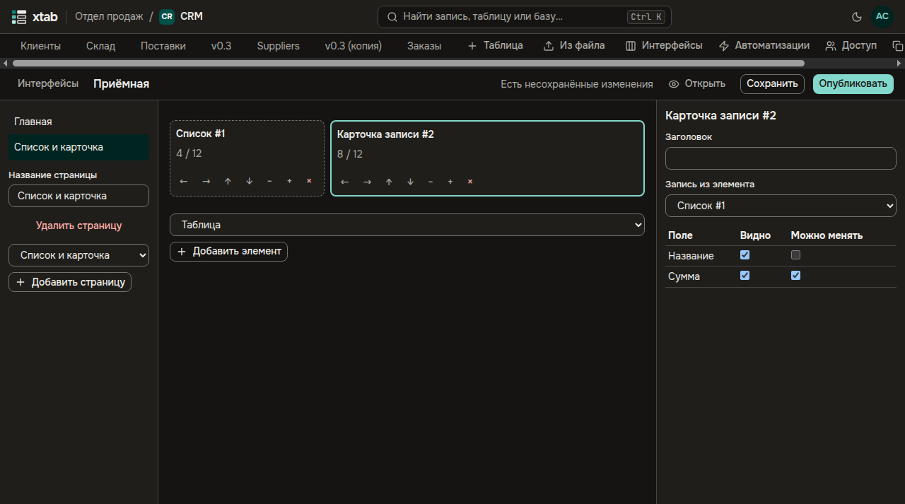
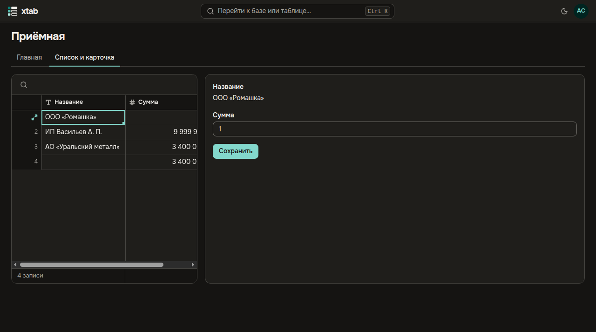

Интерфейс — приложение поверх базы: несколько страниц из готовых элементов, через которые люди работают с записями, не видя базу целиком. Создатель базы собирает интерфейс в конструкторе и публикует; участники базы и те, кому интерфейс выдан, работают в опубликованной версии.

- **Открыть конструктор:** кнопка **Интерфейсы** в строке таблиц базы. Список показывает интерфейсы базы и их состояние: **Не опубликован**, **Есть неопубликованные изменения** или **Опубликован**. Введите название и нажмите **Новый интерфейс**.
- **Страницы** — слева. Выберите макет и нажмите **Добавить страницу**: **Список и карточка** — список записей и карточка выбранной записи, **Дашборд** — числа и таблица, **Форма** — поля новой записи и кнопка **Отправить**, **Пустой холст** — пустая страница. Название страницы меняется в поле под списком.
- **Элементы** стоят в ячейках сетки из 12 колонок. Выберите вид в списке под сеткой и нажмите **Добавить элемент**. Ячейку можно перетащить мышью перед другой ячейкой, в конец строки или между строками — тогда она встанет новой строкой. Кнопки ячейки делают то же с клавиатуры: двигают её левее, правее, выше и ниже, делают уже и шире и удаляют элемент.
- **Настройки элемента** — справа, после щелчка по ячейке: заголовок, таблица, поля с флажками **Видно** и **Можно менять**, что можно делать с записями, **Обязательный фильтр** — его пользователи не видят и не снимают, **Фильтры страницы**, которые сужают элемент. У карточки — элемент, чья выбранная запись показывается; у числа — что считать; у кнопки — действие: **Создать запись**, **Изменить запись**, **Открыть адрес** или **Запустить автоматизацию** с событием **Нажата кнопка**.

- **Сохранить** записывает черновик, **Опубликовать** — сохраняет и показывает его пользователям. Пока интерфейс не опубликован заново, пользователи работают в прежней версии.
- **Открыть** — интерфейс так, как его видят пользователи: страницы — вкладки сверху. Запись, выбранная в списке, открывается в карточке; поля, которые карточка позволяет менять, меняются в ней и записываются кнопкой **Сохранить**. Изменения других людей появляются сами.

- **Доступ:** кнопка **Доступ** у интерфейса в списке выдаёт его участнику организации или группе на **Просмотр** — читать то, что показывают элементы, — или на **Работу** — ещё и менять, создавать и нажимать кнопки. Тот, кому выдан только интерфейс, не видит базу и находит интерфейс в разделе **Интерфейсы** на главной.
- При копировании базы её интерфейсы копируются неопубликованными и никому не выданными.
