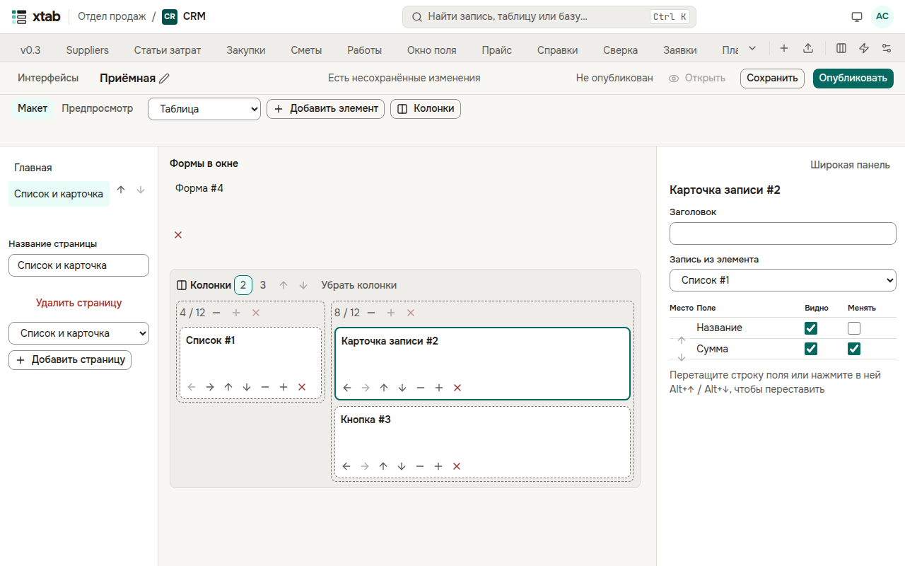
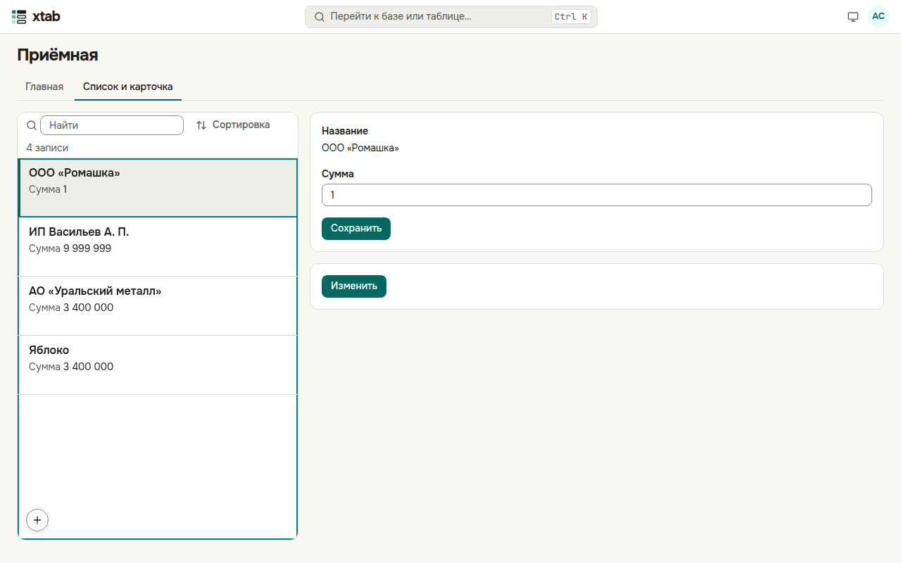

Интерфейс — приложение поверх базы: несколько страниц из готовых элементов, через которые люди работают с записями, не видя базу целиком. Создатель базы собирает интерфейс в конструкторе и публикует; участники базы и те, кому интерфейс выдан, работают в опубликованной версии.

- **Открыть конструктор:** кнопка **Интерфейсы** в строке таблиц базы. Список показывает интерфейсы базы и их состояние: **Не опубликован**, **Есть неопубликованные изменения** или **Опубликован**. Введите название и нажмите **Новый интерфейс**. Меню интерфейса — кнопка со значком ползунков в его строке (подсказка «Действия с интерфейсом «…»»): **Переименовать интерфейс** открывает поле названия на месте строки (Enter сохраняет, Escape отменяет), **Удалить интерфейс** спрашивает подтверждение.
- **Название и описание интерфейса** меняются сразу, без публикации. Название — в строке конструктора: щёлкните его или выделите клавишей Tab и нажмите Enter, введите новое и нажмите Enter или перейдите к другому полю; Escape отменяет правку. Пустым название быть не может: если очистить поле, останется прежнее название, а рядом появится пояснение. Описание — в **Настройках интерфейса** справа, пока не выбран ни один элемент: оно сохраняется, когда вы уходите из поля.
- **Страницы** — слева. Выберите макет и нажмите **Добавить страницу**: **Список и карточка** — слева список записей, справа карточка выбранной записи и под ней кнопка **Изменить**, **Дашборд** — числа и таблица, **Форма** — форма новой записи, **Пустой холст** — пустая страница. Новая страница встаёт последней. Чтобы переставить страницу, перетащите её в списке выше или ниже либо выделите её клавишей Tab и нажимайте Alt+↑ и Alt+↓; у открытой страницы для этого есть и кнопки со стрелками **Выше** и **Ниже**. Строка под списком называет новое место страницы; пользователи увидят новый порядок после публикации. Название страницы меняется в поле под списком; пустым оно быть не может — если очистить поле, останется прежнее название. Перед удалением страницы с элементами кнопка **Удалить страницу** спрашивает подтверждение — с названием страницы и числом элементов: отменить удаление нельзя. Пустая страница удаляется сразу. В окне уже 1024 px — например, 1280 или 1440 px при масштабе 150 % — страницы открываются кнопкой **Страница: …** над холстом, а холст и настройки стоят рядом; в окне уже 768 px настройки идут под холстом, и конструктор прокручивается целиком: кнопка **К настройкам** над холстом ведёт к настройкам выбранного элемента, **К холсту** вверху настроек — обратно к нему.
- **Макет и предпросмотр:** над холстом — переключатель **Макет / Предпросмотр**. **Предпросмотр** показывает страницу так, как её увидят пользователи, с настоящими записями базы от вашего имени — ещё до публикации. Щелчок по элементу или по его ярлыку с видом и номером выбирает его: настройки открываются справа, а на рамке появляются кнопки ячейки; Escape снимает выбор. Элемент, правка которого ещё не сохранена, виден бледным с пометкой «Обновится после сохранения», новый — после сохранения. Данные предпросмотра сами не обновляются — нажмите **Обновить данные**. Записи в предпросмотре настоящие: правка ячеек и полей карточки и новая запись выполняются сразу, удаление — после подтверждения, а кнопки **Создать запись**, **Изменить запись**, **Удалить запись** и **Запустить автоматизацию** и отправка формы сначала спрашивают «Это настоящие данные…». Выбранный вид холста запоминается на этом устройстве.
- **Элементы** стоят в ячейках сетки из 12 колонок. Выберите вид в списке над холстом — рядом с переключателем **Макет / Предпросмотр** — и нажмите **Добавить элемент**: новый элемент встаёт отдельной строкой сразу под строкой выбранного элемента (под всей строкой колонок, если выбранный стоит в колонке), а если ничего не выбрано — в конец страницы; он становится выбранным, и холст прокручивается к нему. Список и кнопки видны, как бы далеко ни был прокручен холст. В **Макете** ячейку можно перетащить мышью перед другой ячейкой, в конец строки или между строками — тогда она встанет новой строкой. Кнопки-значки ячейки (стрелки, минус, плюс и крестик; подсказка называет действие и элемент, например «Правее: Таблица #3») делают то же с клавиатуры: двигают её левее, правее, выше и ниже (элемент, который один в строке и не помещается в соседнюю, меняется с ней местами; у элемента, который один в верхней строке, **Выше**, а в нижней — **Ниже** неактивны: дальше некуда), делают уже и шире и удаляют элемент. Новый **Фильтр** сразу предлагает первое поле своей таблицы — остальные отметьте в его настройках; последнее поле фильтра и формы не снимается — сначала отметьте другое. Удалённый **Фильтр** просто перестаёт сужать элементы страницы. Если удалить таблицу, список или канбан, из которых карточки, кнопки или формы берут запись, конструктор назовёт эти элементы и спросит подтверждение; после удаления выберите им источник в **Запись из элемента** заново — до этого интерфейс не сохранится. Если удалить форму, которую открывают кнопки, конструктор тоже их назовёт: их действие сменится на **Создать запись** (для формы новой записи) или **Изменить запись** — задайте им значения.
- **Колонки** собирают элементы в группы рядом друг с другом: в строке 2 или 3 колонки, в каждой — свои элементы сверху вниз, и высота колонки не зависит от соседних (например, слева таблица, справа карточка и кнопки под ней). Кнопка **Колонки** над холстом добавляет строку из двух пустых колонок по половине ширины — туда же, куда встаёт новый элемент; кнопка **В колонки** у ячейки в **Макете** превращает её строку из 1–3 ячеек в колонки тех же ширин. В заголовке строки колонок — число колонок (**2** или **3**), перенос строки выше и ниже и **Убрать колонки**: элементы раскладываются обратно по строкам ячеек, ничего не удаляется. В заголовке колонки — её ширина из 12 и кнопки **Колонка уже**, **Колонка шире** (в пределах свободного места строки) и **Удалить колонку** — её элементы переходят в соседнюю колонку. Элемент попадает в колонку перетаскиванием или кнопками: **Ниже** у ячейки над строкой колонок ставит её наверх первой колонки, **Выше** у ячейки под ней — вниз; в колонке **Выше** и **Ниже** двигают элемент по колонке, а у края выводят его в соседнюю строку, **Левее** и **Правее** переносят его в соседнюю колонку. После переноса строка над холстом называет новое место элемента, например «Колонка 2 из 3, место 1: Таблица #3».
- **Настройки элемента** — справа, после щелчка по ячейке: заголовок, таблица, поля с флажками **Видно** и **Можно менять** (отметка **Можно менять** показывает и поле, а снятая **Видно** снимает и **Можно менять**), что можно делать с записями, **Обязательный фильтр** — его пользователи не видят и не снимают, **Фильтры страницы**, которые сужают элемент. У карточки — элемент, чья выбранная запись показывается; у числа — что считать; у кнопки — действие: **Создать запись**, **Изменить запись**, **Открыть адрес** или **Запустить автоматизацию** — автоматизации, среди поводов которой есть **Нажата кнопка в интерфейсе**. Новая карточка сразу показывает записи элемента с записями на странице. Если сменить элементу таблицу или карточке и кнопке — элемент, чью запись они берут, поля карточки выбираются заново по новой таблице, а значения кнопки **Изменить запись** и автоматизация кнопки сбрасываются. Конструктор показывает текущие поля таблиц — и после правок в другой вкладке браузера, когда вы к нему возвращаетесь; редактор автоматизации — при каждом открытии. Поле, удалённое из таблицы, конструктор показывает как **Поле удалено**. Из списков полей элемента, элемента **Фильтр** и значений кнопки такие поля при сохранении убираются сами, а поле стопок канбана и поле, которое считает число, нужно выбрать заново — до этого интерфейс не сохранится. Условие **Обязательного фильтра** на удалённое поле выделено и показано как **Поле удалено**, а условие, которое не подходит к новому типу поля, — как **Оператор не подходит к полю**, а условие со значением не того вида (например, текст у числового поля) просто выделено: удалите или исправьте его — до этого интерфейс не сохранится и не опубликуется. Так же не сохранится и не опубликуется элемент, представление которого фильтрует по удалённому полю или по полю другого типа: измените и сохраните фильтр представления в таблице.
- **Ширина панели настроек:** чтобы сделать панель шире или уже, перетащите её левую границу. С клавиатуры — выделите границу клавишей Tab и нажимайте стрелки (с Shift — крупнее, Home и End — самая узкая и самая широкая). Двойной щелчок по границе возвращает исходную ширину. Без перетаскивания — кнопка **Широкая панель** вверху панели: она делает панель самой широкой, повторное нажатие возвращает исходную ширину. Ширина запоминается на этом устройстве для вашей учётной записи; другие пользователи её не видят. Панель бывает не уже исходной и не шире половины окна; в узком окне, где конструктор в одну колонку, нет ни границы, ни кнопки **Широкая панель**.

- **Создавать** и **Менять** — разные действия. С **Менять** новая запись появляется в таблице сразу, и её поля заполняют в ячейках. С **Создавать** без **Менять** в **Таблице** кнопка **+**, строка **+** под записями и Shift+Enter открывают внизу **строку новой записи**: в ней заполняются только ячейки полей, отмеченных **Можно менять**, остальные — на сером фоне, с подставленными значениями обязательного фильтра или пустые. В строке над таблицей видна подсказка: F2, ввод символа или двойной щелчок — изменить ячейку (флажок — пробел), Tab и Shift+Tab — к следующему заполняемому полю, Enter — создать запись, Escape — отменить. Запись создаётся и тогда, когда вы что-то ввели и перешли стрелкой или щелчком на другую строку; переход в другое место страницы ничего не создаёт. Если ничего не введено, Enter не создаёт запись и подсказывает заполнить поле; Shift+Enter создаёт запись и сразу открывает следующую строку. Если сервер отклонил значение, ячейка выделяется красной рамкой со значком, а строка над таблицей называет поле и причину. К новой записи здесь файлы не прикладываются. После создания запись в интерфейсе не изменить. В **Списке** и **Канбане** с **Создавать** без **Менять** кнопка **+** открывает окно новой записи: поля заполняют и нажимают **Создать** (**Отмена** ничего не создаёт). Вставка (Ctrl+V) новых записей при этом не добавляет. Удалить запись в элементе — значком корзины, в меню выделения или, у **Списка** и **Канбана**, в окне записи — можно, только если ему разрешено **Удалять**; без этого и отмена (Ctrl+Z) не удаляет только что созданную запись. Если **Создавать** включено, а ни одно видимое поле не отмечено **Можно менять**, конструктор предупреждает: записи будут создаваться пустыми.
- **Окно записи в Таблице.** У **Таблицы** нет окна записи со всеми полями таблицы: номер строки, пробел и кнопка в редакторе длинного текста открывают запись, только если в настройках выбрана форма для открытия (**Открывать запись в форме**) — тогда открывается она, а кнопка редактора называется **Открыть в форме**. Длинный текст, связи и вложения правятся прямо в ячейке.
- **Порядок полей Таблицы, Списка, Канбана и Карточки записи.** В таблице полей настроек элемента сверху идут показываемые поля — в том порядке, в каком их увидят пользователи (у **Таблицы** — колонки слева направо), ниже, под заголовком **Не показываются**, — остальные поля таблицы. Чтобы переставить поле, перетащите его строку за маркер в столбце **Место** или за название, нажмите кнопку со стрелкой **Выше** или **Ниже** — они появляются на месте маркера, когда указатель над строкой поля или фокус в ней (на сенсорном экране они видны всегда), — или нажимайте Alt+↑ и Alt+↓, когда фокус в строке поля. Первичное поле, если оно показано, всегда первое. Отмеченное **Видно** поле встаёт последним среди показываемых, поле со снятой **Видно** уходит в **Не показываются**; строка под таблицей называет новое место поля. Пользователи увидят порядок после публикации и у себя его не меняют.
- **Ширина колонок Таблицы.** В **Предпросмотре** потяните край заголовка колонки — ширина сохраняется вместе с черновиком и после публикации действует у всех пользователей. Та же ширина — в настройках элемента, в столбце **Ширина** напротив каждого видимого поля: введите число пикселей от 60 до 600 (число вне этих пределов заменяется ближайшим, с пояснением под полем) или оставьте поле пустым — тогда ширина по умолчанию, 180. Двойной щелчок по краю заголовка в предпросмотре возвращает ширину по умолчанию. Если снять у поля **Видно**, его ширина тоже снимается.
- **Сортировка Таблицы и Списка.** В настройках элемента, в разделе **Сортировка**, нажмите **Добавить сортировку** и выберите поле и направление; полей может быть до трёх, а предлагаются только поля, отмеченные **Видно**. Это порядок записей у всех пользователей; без сортировки записи идут, как в выбранном представлении, а если его нет — в порядке строк таблицы. Поле, у которого сняли **Видно**, выпадает из сортировки. В **Предпросмотре** порядок виден сразу.
- **Менять порядок** — действие **Таблицы** и **Списка**: с ним пользователи с правом **Работа** перетаскивают строки (в **Таблице** — за номер строки, в **Списке** — саму строку) и переставляют выбранную запись клавишами Alt+↑ и Alt+↓. Меню строки открывается правой кнопкой мыши, клавишами Shift+F10 или клавишей контекстного меню, а в **Списке** ещё и кнопкой **Действия с записью** над ним (удобно на сенсорном экране): в нём **Переместить выше** и **Переместить ниже**, а если элементу разрешено и **Создавать** — **Вставить запись выше** и **Вставить запись ниже** (в **Таблице** — когда разрешено и **Менять**). В **Списке** новая запись заполняется в окне или в форме новой записи и встаёт рядом с выбранной; окно или форма пишут, где она встанет, а кнопка **В конец** там же отправит её в конец. Без **Менять порядок** новая запись всегда встаёт в конец — и по Shift+Enter в **Таблице**. Порядок меняется во всей таблице — во всех её представлениях и элементах интерфейсов. Пока у элемента задана сортировка, строки не переставляются — конструктор предупреждает об этом под действиями; предупреждает он и тогда, когда отсортировано представление, из которого элемент берёт записи.
- **Значения фильтров в новой записи.** Новая запись в таблице, списке или канбане интерфейса получает значения фильтров страницы — только в поля, отмеченные **Можно менять**, — и значения обязательного фильтра элемента — в любые поля, даже не отмеченные. Например, при обязательном фильтре «Ответственный — я» новая запись сразу получает вас ответственным и остаётся видна вам. Какие условия подставляют значение — в разделе «Фильтр».
- **Список** — записи строками, а не колонками, как в **Таблице**: в каждой строке крупно основное поле, под ним мелко до четырёх полей с подписями (пустые не показываются). Список — для просмотра и выбора записи: в его строках ничего не меняется, записи меняют **Форма**, **Карточка записи** и кнопки, а **Можно менять** у списка задаёт поля окна новой записи. Свои настройки списка: **Основное поле** (по умолчанию — первичное), **Поля под ним** — флажками, до 4, порядок — кнопками со стрелками **Выше** и **Ниже**, клавишами Alt+↑ и Alt+↓ на флажке или кнопках выбранного поля или перетаскиванием, а строка под списком называет новое место поля (ничего не выбрано — первые три видимых поля после основного в порядке полей элемента), **Группировать по** — одно из видимых полей, порядок групп (у связи — и **По порядку записей** связанной таблицы) и флажок **Группы свёрнуты**.
- **Форма** — элемент для создания, изменения и просмотра одной записи. В настройках справа сначала **Поля таблицы** — короткий список с поиском (**Поиск полей**): у каждого поля значок типа, название и отметка **на форме**, если оно уже стоит на форме. Перетащите поле из списка на форму на холсте — оно встанет туда, где вы его отпустили, — или нажмите **+** в его строке (**Добавить на форму**): поле встанет в конец формы. Ниже — настройки самой формы: **Что делает форма** — **Новая запись** (в выбранной таблице), **Изменение записи** или **Просмотр записи** (запись, выбранная в элементе из **Запись из элемента**); **Только в окне**, **Описание**, **Подпись кнопки** и **Сообщение после отправки**.
- **Поля формы настраиваются на холсте.** Они стоят в сетке из 4 колонок так, как их увидят пользователи; в узкой форме колонок меньше (3, 2, 1), и поле шире доступного занимает всю строку. Поле перетаскивают за его заголовок на другое место, а ширину меняют, потянув за правый край поля. Щелчок по полю (в **Предпросмотре** — по его названию) раскрывает прямо под ним его настройки: **Вид** — **Редактируемое**, **Обязательное**, **Только для чтения**, а у формы новой записи ещё **Задано формой** — значение, которое форма ставит сама, а человек не меняет: постоянное, например `"Новая"`, или формула над записью, выбранной в элементе из **Запись из элемента** (пока значение не введено, у поля остаётся прежний вид); **Ширина** от 1 до 4 колонок, **Подпись**, **Подсказка**, **Показывать, если** и **Убрать с формы**. Открыты настройки только одного поля; Escape или повторный щелчок по названию их закрывают. В **Предпросмотре** поля формы работают как у пользователей, поэтому настройки открывает щелчок по названию поля над полем ввода. С клавиатуры: Tab до названия поля, Enter открывает настройки; пока фокус на названии поля или на его кнопках, внизу поля видны кнопки-значки: стрелки влево и вправо (место раньше или позже), вверх и вниз (строка выше или ниже), минус и плюс (уже или шире) и крестик (убрать с формы); подсказка и экранный диктор называют действие вместе с подписью поля, а строка над холстом — новое место поля. Вычисляемые поля, файлы и все поля формы просмотра — только для чтения. Значения, которые форма ставила полям не на форме (у страниц, сохранённых до появления **Задано формой**), при открытии формы встают в её конец с видом **Задано формой**. Обязательное поле нельзя оставить пустым — форма не отправится и покажет, что заполнить. Изменение записи сохраняет только то, что вы поменяли; если запись тем временем изменил другой, форма предложит **Показать новые значения** или **Сохранить мои поверх**. Поле **Связь** выбирают из записей связанной таблицы по названию — так же и в **Таблице** и **Карточке записи**, где оно отмечено **Можно менять**. Файлы в форме интерфейса только показываются: к новой записи здесь файлы не прикладываются.
- **Только в окне:** форма с этим флажком не стоит на странице, конструктор показывает её строкой **Формы в окне** над сеткой, а поля выбранной такой формы в **Макете** раскладывают под этой строкой, в отдельной рамке с её названием. Её открывают кнопка с действием **Открыть форму** и элементы с записями: **Открывать запись в форме** — запись открывается в форме (в таблице — значком у номера строки или клавишей Space), **Новая запись — в форме** — кнопка **+** открывает форму новой записи, и запись получает значения обязательного фильтра элемента (например, «Ответственный — я»). Escape и **Отмена** закрывают окно, при несохранённых правках сначала спрашивают. Макет **Список и карточка** сразу ставит под карточкой кнопку **Изменить**, которая открывает форму выбранной записи. В обоих списках можно выбрать только подходящие формы страницы; остальные видны в списке недоступными, с причиной — например, «форма новой записи: выберите её в «Новая запись — в форме»». Кнопки **Создать форму изменения** и **Создать форму новой записи** под списками добавляют форму **Только в окне** и сразу выбирают её. Если форма перестала подходить — сменили её режим или таблицу элемента, сняли **Создавать**, — ссылка на неё снимается сама, и черновик сохраняется. **Форма**, добавленная на страницу с таблицей, списком или канбаном, берёт таблицу этого элемента, а форма изменения или просмотра без элемента с записями получает первый такой элемент, добавленный на страницу.
- **Форма новой записи подстраивается под фильтры элемента.** Если форма открыта кнопкой **+** таблицы, списка или канбана с **Новая запись — в форме** или стоит на странице, куда этот элемент добавляет записи, она учитывает обязательный фильтр элемента, фильтр его представления и фильтры страницы, чтобы новая запись точно появилась в этом элементе. Поле, которому фильтр оставляет одно значение (например, «Проект — Альфа»), показывается только для чтения с этим значением и пометкой **Задано фильтром** (у поля **Связь** — с названием записи); если вариантов несколько («Проект — любой из Альфа, Бета»), в списке остаются только они — и у поля **Пользователь** тоже, — и поле становится обязательным; «не пусто» тоже делает поле обязательным. Под числом или датой с условием «больше», «меньше» или «между» написана граница: календарь даты предлагает только подходящие дни, а число или дату за границей форма не отправляет и сразу показывает у поля, что допускает фильтр. Под полем с условием, которое нельзя свести к выбору (например, «содержит»), — «Запись должна подходить под фильтр …». Если условие охватывает несколько полей через «или», эта подсказка показана один раз над кнопками. Значения, которые фильтр требует сохранить (например, «Метки — содержат все из: Срочно»), уже стоят в поле плашками без крестика и не убираются ни крестиком, ни клавишей Backspace; другие значения можно добавить. Запись связи, которую фильтр требует сохранить, в списке не предлагается. Если при отправке значение всё же не подходит, форма не создаёт запись и показывает у нужного поля, что допускает фильтр (например, «Можно: Альфа, Бета» или «Больше 100»). Значение, которое задаёт сама форма, помечено **Задано формой**; значение, которое ставит фильтр, важнее его; конструктор предупреждает об этом, о фильтрах, которые противоречат друг другу, и о полях с условиями фильтра, которых нет на форме. Форма изменения записи фильтрами не ограничивается.
- **Кнопки:** **Удалить запись** удаляет запись, выбранную в элементе, после подтверждения — если элементу разрешено **Удалять**. Кнопка, которой нужна выбранная запись, неактивна, пока запись не выбрана. Надпись кнопки не может быть пустой: если её стереть, останется прежняя. Кнопка **Создать запись** без значений создаёт пустую запись — конструктор предупреждает об этом; чтобы человек заполнил поля, выберите **Открыть форму**. Сохранённые раньше страницы с **Полями записи** открываются как форма новой записи с той же кнопкой.
- **Текст** — заголовки, абзацы и списки. Строка, которая начинается с «# », — заголовок, с «## » — подзаголовок, с «- » — пункт списка; строки подряд остаются одним абзацем с переносами, а пустая строка начинает новый абзац. Подсказка — под полем текста в настройках элемента.

- **Черновик сохраняется сам** примерно через секунду после последней правки; строка конструктора показывает «Сохраняется…», «Сохранено в 12:34» или ошибку с её местом — страницей и элементом; рамка такого элемента выделена. **Сохранить** сохраняет сразу, **Опубликовать** — сохраняет и показывает черновик пользователям. Если сохранение не прошло из-за сбоя сети, **Опубликовать** дожидается его повтора; если сохранить или опубликовать черновик не удалось, строка конструктора показывает «Не опубликовано: …» с причиной. Пока интерфейс не опубликован заново, пользователи работают в прежней версии. Если закрыть вкладку, пока правки не сохранены, браузер предупредит. Если черновик тем временем сохранили в другой вкладке или другой создатель базы, сохранение останавливается и конструктор предлагает **Загрузить сохранённый** — ваши несохранённые правки пропадут — или **Сохранить мой поверх**.
- **Открыть** — интерфейс так, как его видят пользователи; до первой публикации кнопка неактивна. Страницы — вкладки сверху. Первая сверху строка с таблицей, списком или канбаном растягивается до низа окна, а элементы под ней прижимаются к нижнему краю; если это строка колонок, растягиваются только колонки с таблицей, списком или канбаном, а остальные остаются высотой в своё содержимое; ниже обычной высоты таблица не становится — если элементов много, прокручивается страница. Запись, выбранная в списке, открывается в карточке; поля, которые карточка позволяет менять, меняются в ней и записываются кнопкой **Сохранить**. Изменения других людей появляются сами. На узком экране колонки встают друг под другом по порядку: сначала первая колонка целиком, потом вторая. Если таблицу изменили так, что фильтр элемента ссылается на удалённое поле или на поле другого типа, элемент пишет «Элемент устарел…» — сообщите создателю базы.
- **Ширина колонок у себя:** в опубликованной **Таблице** потяните край заголовка колонки. Ширина запоминается на этом устройстве для вашей учётной записи, этого интерфейса и этой таблицы и сохраняется после перезагрузки; другие пользователи её не видят. Двойной щелчок по краю возвращает ширину, которую задал создатель интерфейса. Порядок колонок в интерфейсе не меняется.
- **Сортировка у себя:** кнопка **Сортировка** над **Таблицей** или **Списком** открывает панель: **Добавить сортировку**, поле и направление, до трёх полей. Ваш порядок видите только вы: он запоминается на этом устройстве для вашей учётной записи, этого интерфейса и этого элемента и сохраняется после перезагрузки, а кнопка выделена цветом. Без него панель показывает порядок по умолчанию, который задал создатель. **Сбросить** возвращает порядок создателя. В **Таблице** у заголовка отсортированной колонки — стрелка направления. Пока действует сортировка, строки не перетаскиваются: при попытке над элементом появится подсказка.
- **Работа со списком:** щелчок по строке, Enter или Space выбирают запись — строка подсвечивается полосой слева, а если у списка задано **Открывать запись в форме**, запись сразу открывается в форме. Стрелки ↑ и ↓ переходят по строкам, PageUp и PageDown — на экран, Home и End — к первой и последней записи. Над списком — поиск по видимым полям и число записей; кнопка корзины и клавиша Delete удаляют выбранную запись после подтверждения, если списку разрешено **Удалять**. В сгруппированном списке щелчок по заголовку группы или клавиши ← и → сворачивают и разворачивают группу активной строки. Кнопка **+** внизу открывает окно новой записи или форму новой записи.

- **Доступ:** кнопка **Доступ** у интерфейса в списке выдаёт его участнику организации или группе на **Просмотр** — читать то, что показывают элементы, — или на **Работу** — ещё и менять, создавать и нажимать кнопки. На **Просмотре** форма изменения показывает запись без правки, а форма новой записи — без кнопки, с пометкой «Нет права создавать записи». Тот, кому выдан только интерфейс, не видит базу и находит интерфейс в разделе **Интерфейсы** на главной.
- При копировании базы её интерфейсы копируются неопубликованными и никому не выданными.
