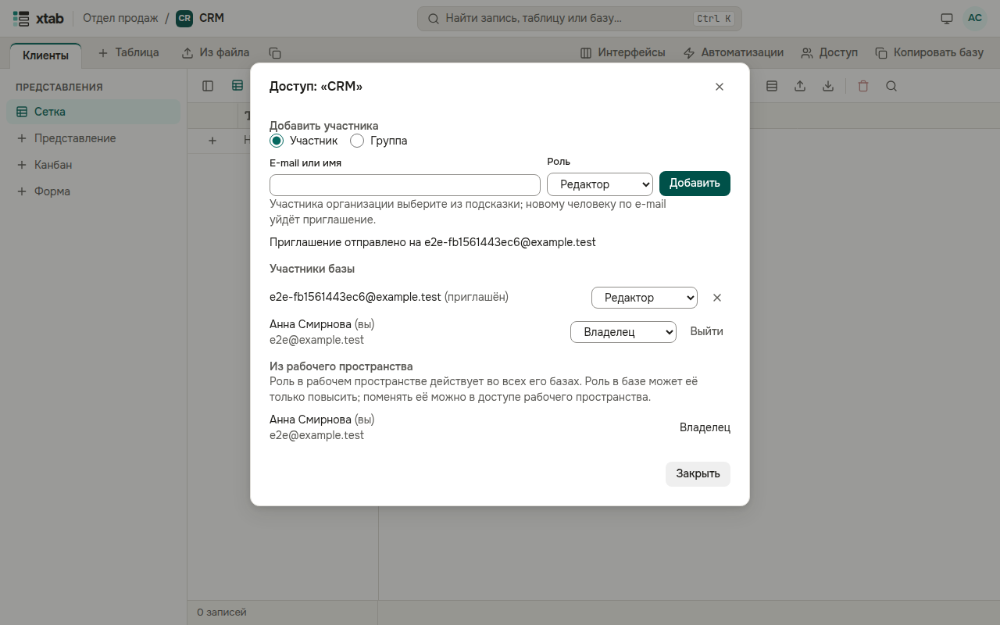
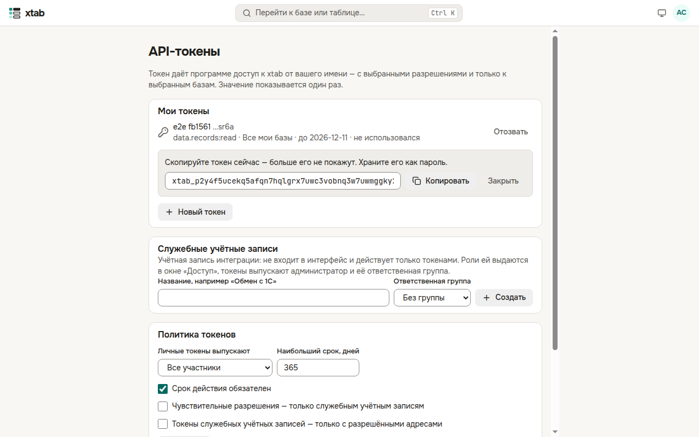

Изменения других людей появляются в вашей таблице сами, без обновления страницы: новые и удалённые записи, правки ячеек, новые поля.

## Доступ к пространству и базе

Кто работает в базе, видно по кнопке **«Доступ»** в конце строки вкладок таблиц; у рабочего пространства такая же кнопка — в его заголовке на главной.

- В окне — участники с их ролями: **Читатель** видит данные, **Комментатор** ещё и комментирует, **Редактор** меняет записи, **Создатель** меняет таблицы, поля и представления, **Владелец** управляет всем, в том числе доступом.
- Роль в рабочем пространстве действует во всех его базах. В окне базы такие участники показаны отдельно — «Из рабочего пространства»; роль в базе может её только повысить.
- Чтобы добавить человека, впишите его e-mail или имя, выберите роль и нажмите **«Добавить»**. Участника организации можно выбрать из подсказки — роль появится сразу; новому человеку по e-mail уйдёт приглашение.
- Роль меняется в списке у человека, крестик убирает доступ. Создатель выдаёт роли до «Редактора», владелец — любые. Последнего владельца убрать нельзя.
- Кнопка **«Выйти»** у вашей строки убирает ваш собственный доступ.
- Роль можно выдать и группе: в форме выберите **«Группа»**, затем группу и роль. Все участники группы получают эту роль.

## API-токены

Токен даёт программе (например, обмену с 1С или отчёту в BI) доступ к xtab от вашего имени. **Меню учётной записи → «API-токены»**.

- **«Новый токен»**: впишите, для чего он, отметьте разрешения (чувствительные помечены), выберите все свои базы или только нужные, срок действия и, если нужно, адреса, с которых его можно использовать. xtab попросит ваш пароль.
- Значение токена показывается один раз — нажмите **«Копировать»** и сохраните его как пароль. Потом виден только хвост из четырёх знаков.
- **«Отозвать»** сразу выключает токен.
- **Служебные учётные записи** — для интеграций, которые не должны зависеть от сотрудника. Их создаёт администратор, роли им выдаются в окне «Доступ», а токены выпускают администратор и участники ответственной группы.

- Администратор организации здесь же задаёт политику токенов (кто выпускает, наибольший срок, ограничения) и видит все токены организации.
