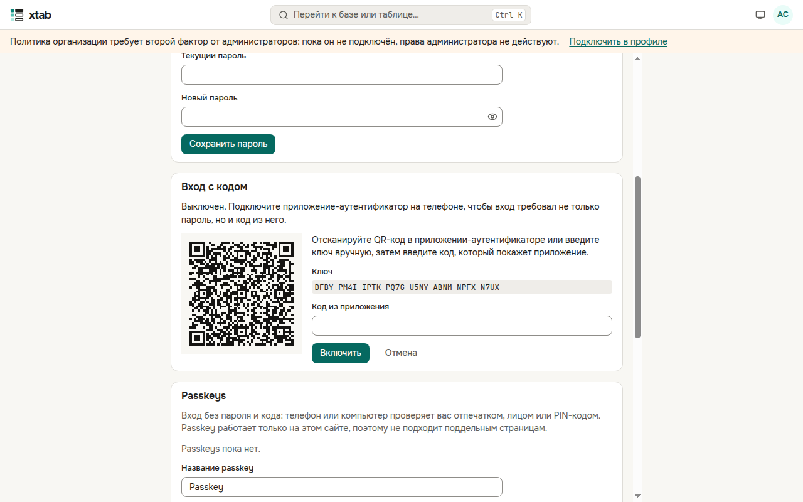
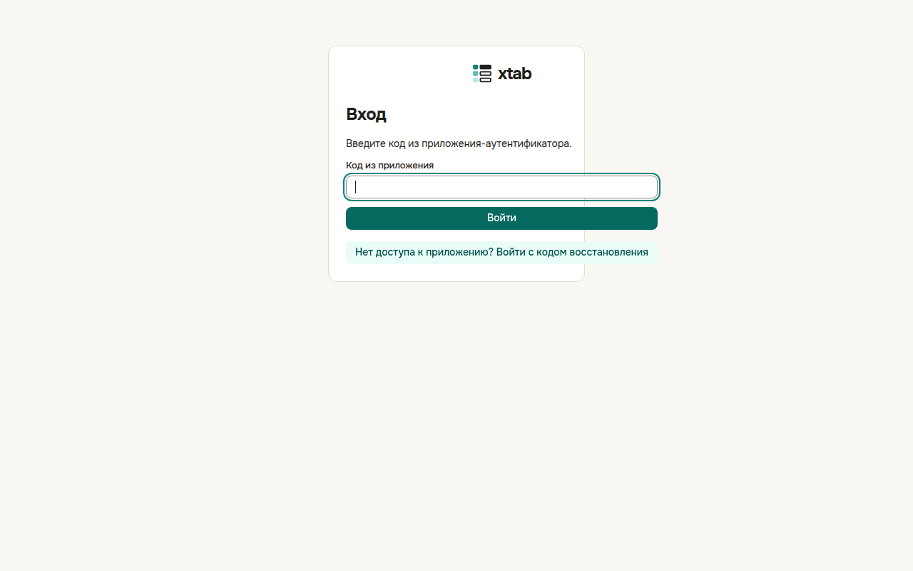
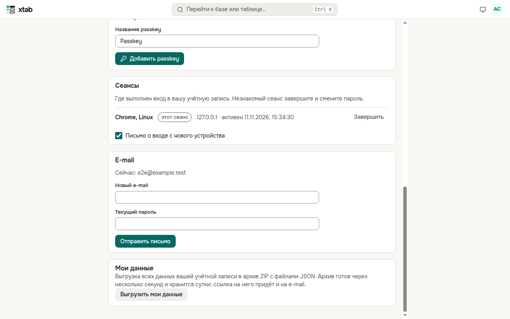
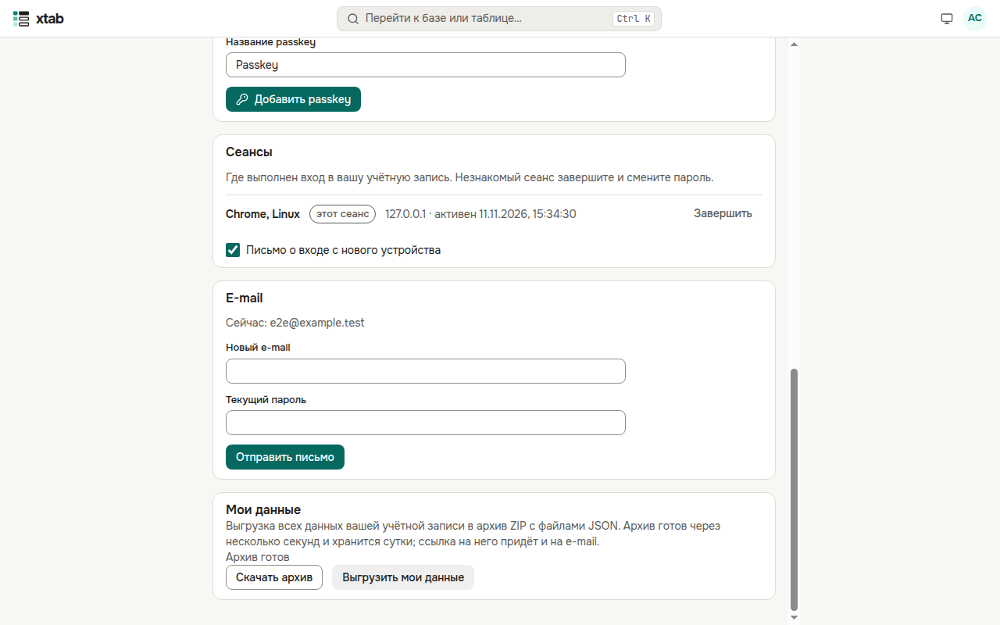

Свою учётную запись вы настраиваете в профиле: **кружок с инициалами → «Профиль»**.

## Профиль

- **Фото** — JPEG, PNG или WebP до 1 МБ; его видят все участники организации. **«Убрать фото»** возвращает инициалы.
- **Имя** и **часовой пояс**, в котором показываются даты, — нажмите **«Сохранить»**.
- **Пароль**: введите текущий и новый. Остальные ваши сеансы при смене завершатся.
- **E-mail**: введите новый адрес и пароль и нажмите **«Отправить письмо»**. Адрес сменится, когда вы откроете ссылку из письма; на старый адрес придёт уведомление.

## Вход с кодом

Второй фактор защищает учётную запись, даже если пароль узнали. Администратору организации он обычно обязателен: пока он не подключён, права администратора не действуют, а сверху страницы видно предупреждение.

1. В разделе **«Вход с кодом»** нажмите **«Подключить приложение»** (xtab попросит пароль).
2. Отсканируйте QR-код приложением-аутентификатором на телефоне (Яндекс Ключ, Google Authenticator и другие) или введите ключ вручную.
3. Введите код из приложения и нажмите **«Включить»**.
4. Сохраните **коды восстановления** в надёжном месте — их покажут только один раз. Каждый код действует один раз, если телефона нет под рукой.

Теперь после пароля xtab спрашивает код из приложения. Нет доступа к приложению — нажмите **«Нет доступа к приложению? Войти с кодом восстановления»**.

**Passkeys** — вход без пароля и кода: телефон или компьютер проверяет вас отпечатком, лицом или PIN-кодом. Нажмите **«Добавить passkey»** и следуйте подсказкам браузера; на странице входа появится кнопка **«Войти с passkey»**.

## Вход через провайдера

Если организация подключила корпоративный вход (Active Directory, Keycloak и другие), на странице входа есть кнопка **«Войти через …»**. Чтобы входить так и в уже существующую учётную запись, в разделе **«Вход через провайдера»** профиля нажмите **«Привязать»** и войдите у провайдера. **«Отвязать»** убирает привязку; последний способ входа отвязать нельзя.

## Сеансы

Раздел **«Сеансы»** показывает, где выполнен вход в вашу учётную запись: браузер, система, адрес и когда сеанс был активен; текущий отмечен «этот сеанс». Незнакомый сеанс завершите кнопкой **«Завершить»** и смените пароль. **«Завершить все остальные»** оставляет только текущий.

## Мои данные

Нажмите **«Выгрузить мои данные»** (xtab попросит пароль): через несколько секунд будет готов архив ZIP с профилем, группами и ролями, сеансами, API-токенами без их значений и событиями журнала аудита о вас. Нажмите **«Скачать архив»**; если в организации настроена почта, ссылка на архив придёт и на e-mail. Архив хранится сутки.

