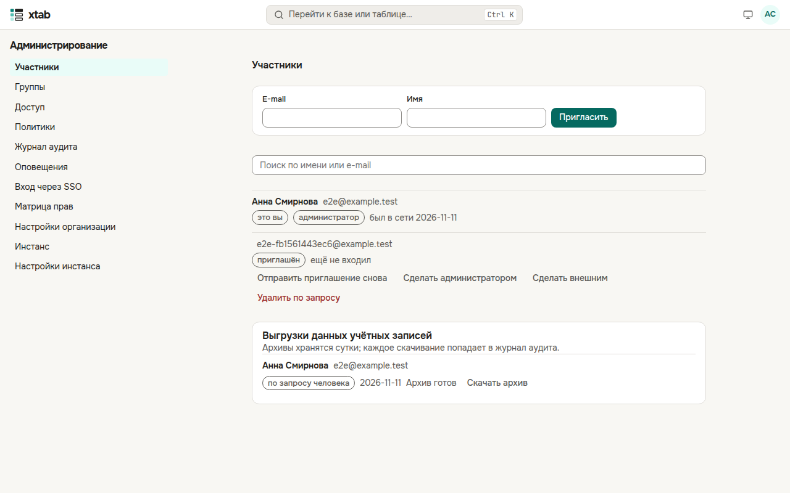
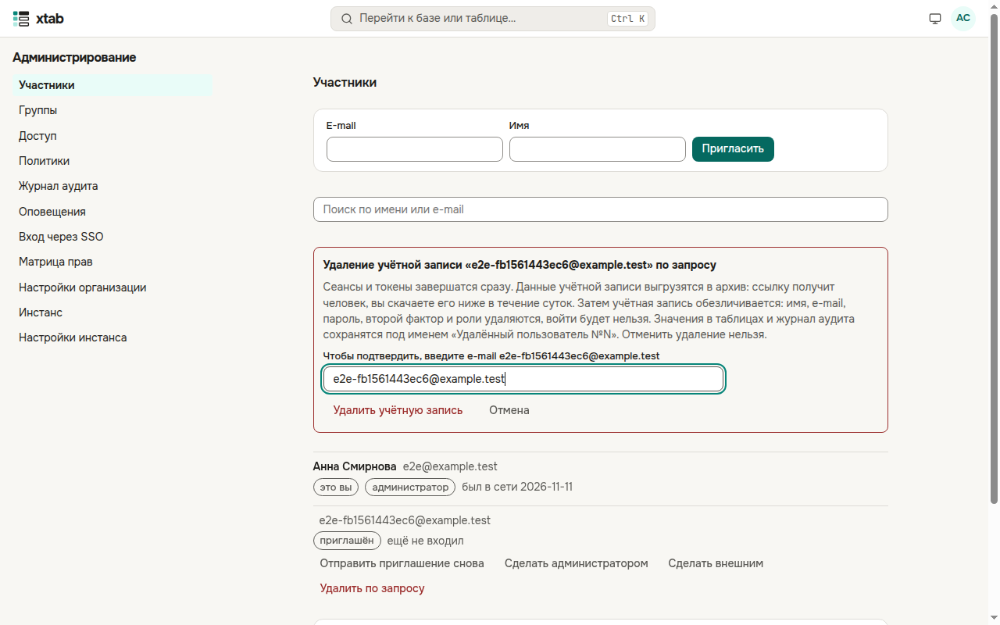
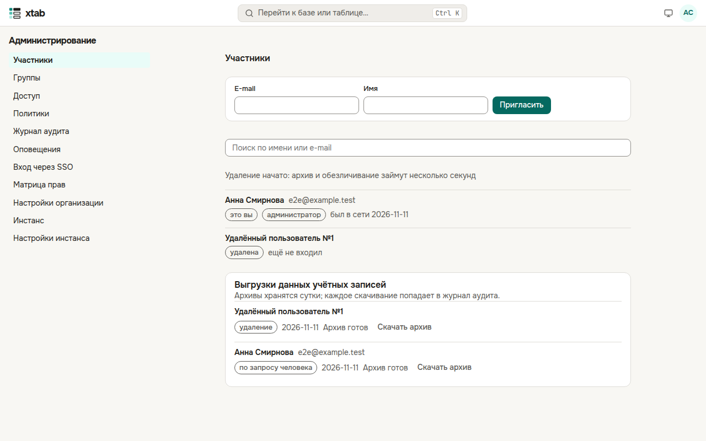
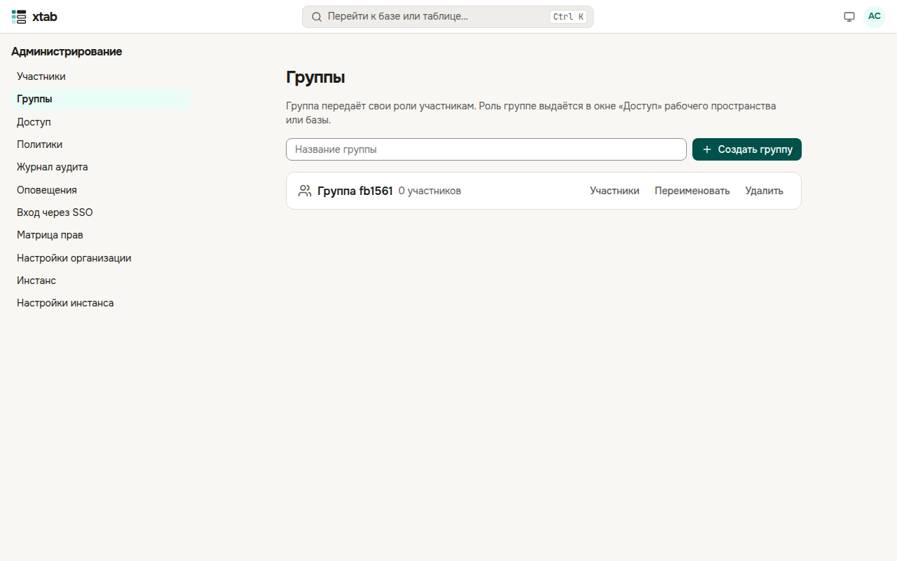
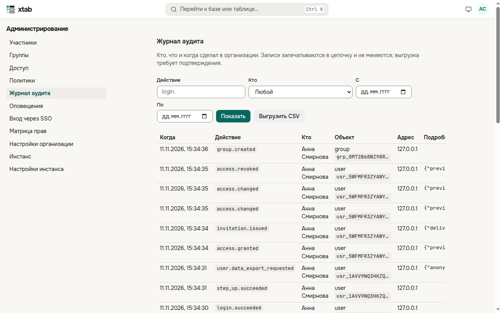
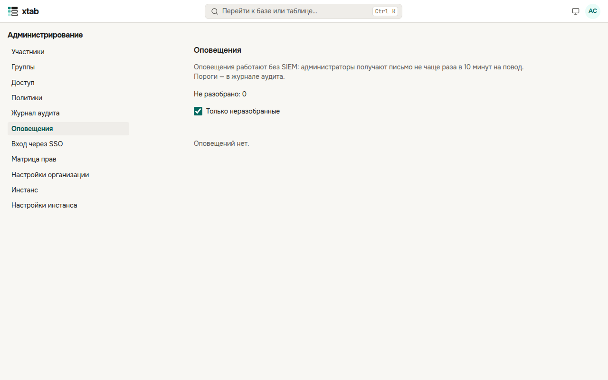
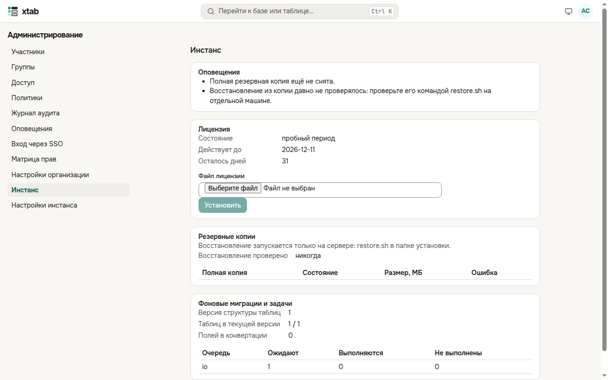
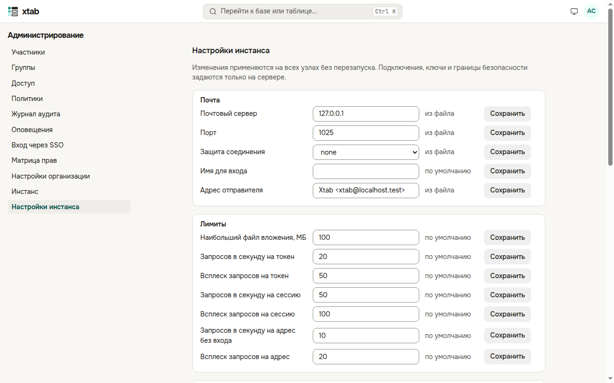

Администратор организации управляет ею в разделе **«Администрирование»** меню учётной записи. Данные баз администратору не видны, пока у него нет роли (см. «Доступ» ниже). Действия, меняющие безопасность, xtab подтверждает паролем.

## Участники

- **«Пригласить»**: впишите e-mail и имя — человеку уйдёт приглашение. Список ищется по имени или e-mail.
- У каждого участника видно: администратор ли он, есть ли второй фактор, заблокирован ли вход после неверных паролей и когда он был в сети.
- Кнопки у участника: **«Заблокировать»** / **«Разблокировать»** (блокировка сразу завершает его сеансы и токены), **«Сделать администратором»** / **«Снять права администратора»**, **«Завершить сеансы и отозвать токены»** (например, при потере ноутбука), **«Сбросить второй фактор»** (если человек потерял телефон и коды), **«Снять блокировку входа»**, **«Отправить приглашение снова»**.

**Внешние участники** отмечены словом «внешний». Внешний участник видит в списках людей только себя и тех, с кем у него общие пространства и базы, не создаёт рабочие пространства и не приглашает людей. Отметку ставит xtab, когда администратор приглашает человека не с доменов организации, или сам администратор кнопкой **«Сделать внешним»**; снимает — **«Снять отметку «внешний»»**.

**Удаление по запросу человека.** Нажмите **«Удалить по запросу»**, впишите e-mail удаляемой учётной записи и нажмите **«Удалить учётную запись»** (xtab попросит пароль). Сеансы и токены человека завершатся сразу. Через несколько секунд:

- данные учётной записи выгружаются в архив — человек получит ссылку на него письмом (если настроена почта), а вы скачаете его в списке **«Выгрузки данных учётных записей»** ниже (архив хранится сутки, каждое скачивание записывается в журнал аудита);
- учётная запись обезличивается: имя, e-mail, пароль, второй фактор, роли и группы удаляются, войти в неё нельзя, а её e-mail можно пригласить снова;
- значения в таблицах и журнал аудита сохраняются под именем «Удалённый пользователь №N».

Удаление нельзя отменить. Себя удалить нельзя — это делает другой администратор.

## Группы

- Впишите название и нажмите **«Создать группу»**.
- **«Участники»** раскрывает состав группы: добавьте человека по e-mail или имени, крестик убирает его из группы. Если вы добавляете в группу с ролями самого себя, xtab попросит ваш пароль.
- **«Переименовать»** и **«Удалить»** — у каждой группы. Удаление группы убирает и доступ, который она давала.
- Группу можно связать с группой провайдера входа (раздел «Вход через SSO»): её состав будет обновляться при каждом входе.

## Доступ

Все пространства и базы организации с ролями людей и групп. Если у базы не осталось владельца или вам нужно поработать с её данными, нажмите **«Назначить себе»** и выберите роль — владельцы получат письмо, а назначение попадёт в журнал аудита. **«Сделать владельцем»** передаёт базу другому человеку.

## Политики

- **Пароли и блокировка** — длина и состав пароля, запрет повторять прежние, срок действия, блокировка после неверных попыток. Новый пароль также сверяется со списком утёкших.
- **Второй фактор администраторов** — требовать ли его от администраторов (или от всех) и засчитывать ли только passkey.
- **Публичные ссылки** — разрешить ли публичные ссылки на формы.
- **Исходящие адреса** — куда автоматизации могут отправлять запросы и письма (см. «Исходящие адреса»).

Политика API-токенов задаётся на странице «API-токены».

## Вход через SSO

Провайдеры OpenID Connect организации: **«Добавить провайдера»**, впишите название на кнопке входа, адрес издателя, идентификатор и секрет клиента. В настройках провайдера зарегистрируйте **адрес возврата** и **адрес выхода**, показанные на странице. **«Проверить»** убеждается, что провайдер отвечает. Ниже — связи групп организации с группами провайдера и срок сеанса, открытого через провайдера.

## Журнал аудита

Кто, что и когда сделал в организации: входы, изменения прав и политик, выгрузки, действия администраторов. Отберите события по действию, человеку и времени и нажмите **«Показать»**; **«Выгрузить CSV»** сохраняет отобранное (xtab попросит пароль, выгрузка тоже попадает в журнал).

Записи запечатываются в цепочку: каждая связана с предыдущей, контрольные точки подписаны. Раздел **«Цепочка печатей»** показывает последнюю печать и последнюю проверку — если запись изменили или удалили в базе, проверка это найдёт и придёт оповещение. Здесь же — срок хранения журнала в базе (старые месяцы уходят в архив), пороги оповещений и выгрузка в SIEM.

## Оповещения

Без отдельной системы мониторинга xtab сам сообщает о подозрительном: администратор назначил себе доступ, массовый экспорт, токен из новой сети, всплеск отказов в доступе, массовая блокировка учётных записей, сброс второго фактора администратора, отключение обязательного второго фактора, нарушение цепочки журнала. Администраторы получают письмо; в ленте отметьте разобранное кнопкой **«Разобрано»**.

## Матрица прав и настройки

**«Матрица прав»** — что разрешено каждой роли в установленной версии. **«Настройки организации»** — название, часовой пояс и язык организации; смена пояса и языка пересчитывает формулы с датами и текстами, ход пересчёта виден на странице.

## Инстанс

Вкладка **«Инстанс»** раздела «Администрирование» видна администратору всей установки xtab (его назначает администратор сервера) и открывается только с подключённым вторым фактором.

- **Оповещения** — что требует внимания: срок лицензии, давно не снятая резервная копия, не проверенное восстановление, не выполненные фоновые задачи.
- **Лицензия** — состояние (пробный период, действует, льготный период, только чтение), срок, квоты. Файл лицензии от поставщика установите кнопкой **«Установить»**; узлы применят его в течение 5 минут.
- **Резервные копии** — последние полные копии и сегменты журнала базы, когда последний раз проверялось восстановление и сколько оно длилось.
- **Фоновые миграции и задачи** — смена типов полей и очередь фоновых задач.

**«Настройки инстанса»** — почта, лимиты, журналы, правила входа и паролей, резервные копии. Изменения применяются на всех узлах без перезапуска; **«Сбросить»** возвращает значение из настроек сервера или по умолчанию.

**Лицензия у всех.** Незадолго до окончания лицензии или пробного периода над страницей появляется предупреждение. Когда срок и льготный период истекли, данные остаются доступны для чтения и выгрузки, а изменения — нет, пока администратор не установит новую лицензию.
