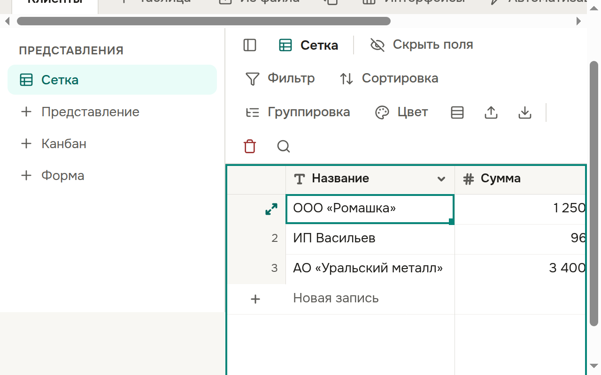

- **Экранный диктор** (NVDA, Orca): при переходе по таблице стрелками диктор называет поле, значение и номер строки, например «Сумма: 1 250 000, строка 3».
- **Крупный шрифт и масштаб:** таблица следует размеру шрифта в настройках браузера и масштабу страницы до 200 % — строки, колонки и редактор ячейки увеличиваются вместе с текстом.
- Работа с таблицей с клавиатуры — см. «Выделение, копирование и вставка» и «Запись целиком».

